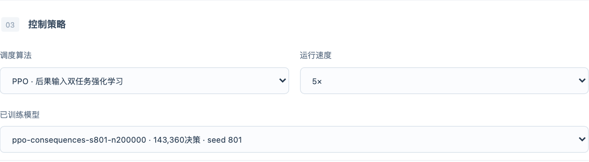
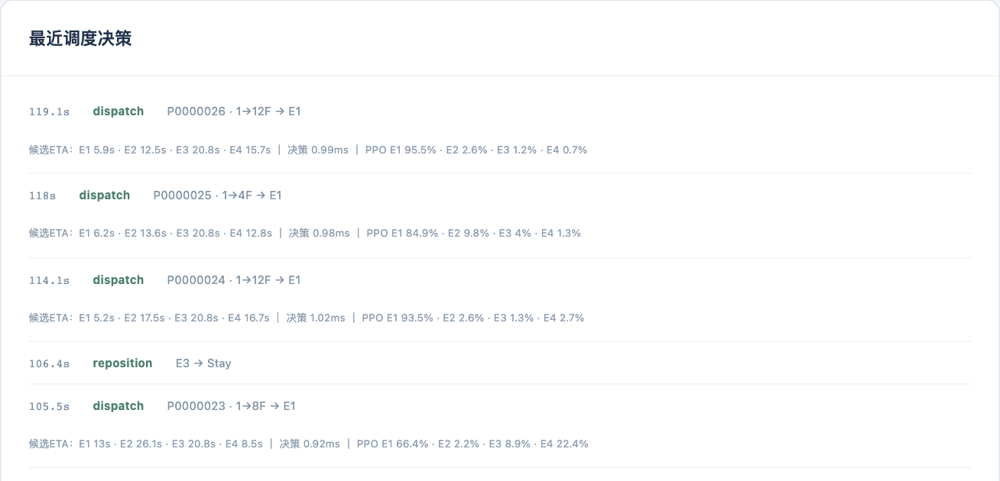
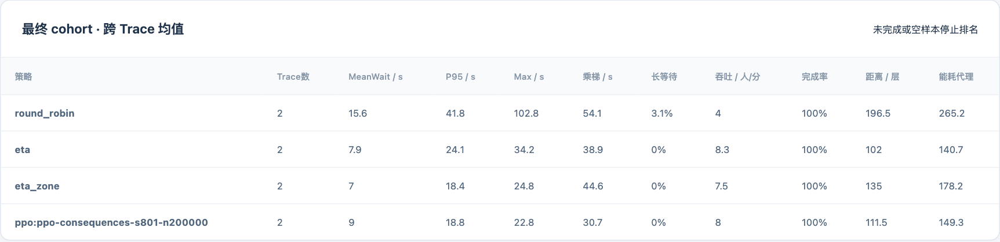
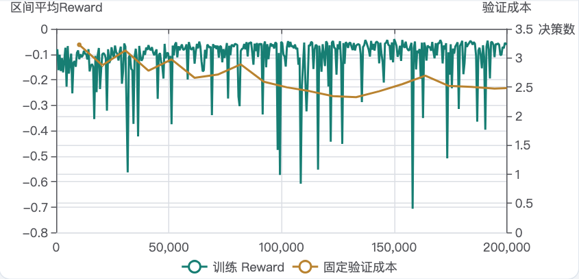

# 基于深度强化学习的多电梯智能群控系统

课程项目报告｜系统设计、关键算法与运行结果｜2026年10月24日

课程名称：________________　小组：________________

成员姓名与学号：________________________________________________

## 1. 项目概述与需求

本项目研究动态客流下的多电梯协同调度。系统在同一个离散事件仿真内核中提供轮询、ETA、ETA-Zone及深度强化学习PPO，支持配置场景、观察运行过程、查看训练曲线、执行同流对比与导出原始数据。近期阶段文档为《问题陈述与需求设计》，本报告展开其实现与验证。

多梯调度同时存在动态性、任务之间的相互影响及多目标冲突。离新乘客最近的电梯接单后可能推迟已有任务；降低等待也可能增加空驶和绕行。因此，系统需要同时保留平均等待、尾部等待、乘梯时间、长等待比例、距离与完成率，而不能只比较一个奖励值。

仿真范围为5—30层、2—8部电梯、容量6—20人。客流覆盖普通办公、早高峰、晚高峰、楼层互访和突发模式。系统面向本地单用户课程实验，不连接实体电梯。策略只读取已经到达的乘客和公开任务，未来客流不进入观测。

功能需求对应场景配置、乘客流生成/导入、事件仿真、策略切换、模型训练/加载及可视化导出。质量需求对应容量与服务守恒、输入可复现、完整服务口径、分层模块结构，以及单元/集成/浏览器验证。运行使用Python 3.11、PyTorch、Gymnasium、FastAPI、React/TypeScript和Node.js；普通CPU即可运行已提供的模型，无须演示时重新训练。

## 2. 数据设计

### 2.1 输入、过程与输出

配置采用经过Pydantic校验的JSON/YAML，分为建筑、物理、仿真、交通、控制器、重定位、指标和奖励。内部时间使用整数微秒；对外配置和指标采用秒，距离采用楼层数或米。规范化配置、乘客流和模型分别具有哈希，避免混用不同输入的结果。

| 数据对象 | 关键字段 | 作用与约束 |
|---|---|---|
| 建筑与物理 | floor_count、elevator_count、capacity、seconds_per_floor、door_open_s | 确定规模、容量、运行和开关门时间 |
| 客流记录 | passenger_id、arrival_time、origin_floor、destination_floor | 编号唯一，楼层有效，起终点不同 |
| 乘客状态 | 分配、上梯、下梯时刻与所属电梯 | 时间顺序一致，每位乘客最多完成一次 |
| 电梯与停站 | 位置、方向、载客量、微阶段、接人/送人任务 | 路线满足容量与冻结停站前缀 |
| 决策记录 | decision_id、时刻、动作、mask、关联乘客 | 绑定当前决策，动作必须合法 |
| 模型记录 | 参数、语义版本、SHA256、训练配置、获选步数 | 版本或权重不匹配时明确拒绝 |

乘客CSV最小示例为：

```csv
passenger_id,arrival_time,origin_floor,destination_floor
P001,0,1,8
P002,5,3,1
```

运行归档保存input_trace.csv、config.json、manifest.json、passengers.csv、decisions.jsonl、events.jsonl、metrics_timeseries.csv、elevator_trace.csv、metrics.json及最终snapshot.json。文件写入采用临时文件后原子替换；SQLite由协调器维护作业索引，计算worker不直接竞争写入数据库。完整原始档案约10.06GB仍保留在开发目录，提交版携带模型、关键曲线、必要示例及可审阅的研究汇总。

### 2.2 PPO观测与动作

观测使用padding和mask处理可变楼层、可变梯数。电梯基础特征为8×24，电梯路线为8×30×8，楼层为30×9，当前请求为5维，全局特征为20维，另有决策类型、楼层和电梯有效掩码。提交版额外提供8×6公开后果表。超出实际规模的槽位不应改变有效电梯的评分，相关置换与padding回归已覆盖。

派梯动作0—7对应最多8台电梯；重定位动作8为Stay，9—12为Lobby/Low/Mid/High。掩码保证两类任务的动作空间互斥，不存在的梯和无效区域不能被采样。自然终止不bootstrap；截断使用最后观测估值，episode边界阻断优势递推。

## 3. 系统总体设计

系统依赖方向为config → domain/traffic → simulator → controllers/env → rl/evaluation → storage → backend/frontend。物理内核不依赖PyTorch、FastAPI或数据库，四类策略使用相同的物理、插入规划和乘客流。前端不自行推进物理状态，只展示服务端的权威快照。

配置与Trace进入Simulator后，事件队列推进到乘客派梯或空闲重定位边界，控制器接收公开视图并返回动作；仿真继续产生事件、成本和指标。Gym环境将同一流程包装为reset/step供PPO训练。服务端协调spawn worker执行仿真、实验与控制命令，HTTP负责配置和产物，WebSocket推送运行状态。

| 模块目录 | 主要职责 | 设计理由 |
|---|---|---|
| config、domain、traffic | 契约、实体、独立客流 | 把输入校验和数据身份放在计算前 |
| simulator | 微阶段物理与可行插入 | 所有策略共用内核，保持比较公平 |
| controllers、env | 控制器接口及Gym观测/奖励 | 将调度策略与物理演化解耦 |
| rl | 编码网络、GAE、PPO、检查点 | 训练与推理共享严格语义版本 |
| evaluation、storage | 同流评价、指标、归档索引 | 支持原始数据重算与完整服务排名 |
| backend、frontend | 作业协调、状态控制、页面展示 | 服务端权威状态，界面可追溯 |

提交版默认运行数据位于artifacts/submission，与历史开发归档隔离。assets/release包含已训练模型、真实训练曲线、课程初始化检查点及全部载荷SHA；安装器先验证再复制，不进行隐式训练，也不覆盖已经被改动的文件。

## 4. 系统关键算法

### 4.1 仿真与路线规划

离散事件内核按微秒时间推进到到达、运行、开门、上客、下客、关门及空闲复查等事件。路线规划在可行位置插入接人和送人停站，检查容量和已冻结的服务前缀。确定性时间与平局规则保证相同输入和动作序列可复现。乘客在到达窗口内入组，窗口结束后继续排空；发生drain超时时明确标记未完成。

轮询依次给梯分配请求；ETA选择预测接人时间最短的梯；ETA-Zone派梯沿用ETA，在空闲时结合近期公开客流进行区域重定位。固定候选规则是额外离线参照，将六项后果按固定系数组合并选择最低分，不能将其成绩标为深度强化学习成绩。

### 4.2 六项公开后果输入

对每台梯分别预测原路线和插入当前请求后的路线，计算新客接到时间、从现在到送达时间、新增距离、已有任务接人延误总和、已有任务送达延误总和以及路线延长。时间按分钟、距离按10层归一化。计算只依赖已经到达的任务；尚未到达乘客的目的地和人数变化不会改变当前候选表。

一个可手算的例子是：两梯均在1层，第一台已有1→5层任务，新请求为2→3层。两梯接新客均需4.8秒，但第一台插入路线2→1→3→5会使旧客额外等8.8秒、晚到13.6秒，第二台接单不延误旧客。新增输入把这种任务外部性显式交给网络，避免只凭相同ETA无法区分后果。该数值已通过独立时间线回归。

### 4.3 深度网络与PPO更新

路线编码器为8→32→32，按有效楼层做mean/max汇聚；与24维电梯基础特征组合后，经共享88→128→128编码。两层4头Attention处理梯间关系。请求与全局上下文形成96维上下文，派梯头接收128维电梯编码、96维上下文及6维后果，即230→128→1。重定位头和critic沿用原结构。模型共427399参数，新增后果输入仅增加768个参数。

部署流程为公开状态与后果表 → 深度网络logits → 合法动作mask → argmax。六项特征没有人工固定调度系数；网络不叠加规则分数、教师动作、行为克隆或规则兜底。原课程模型的派梯首层补六列零权重后初始化，再通过真实PPO更新学习使用后果信息。

奖励为等待、乘梯、能耗代理和长等待成本的负加权和；默认归一化形式为r=−(W/600+0.2R/600+0.05E/10+0.5L/10)，四个成本来自事件区间的实际增量。能耗是距离、门和启动的代理，不能解释为实测电量。

事件间隔为Δt时，折扣采用0.99^(Δt/10)，GAE系数采用0.95^(Δt/10)。rollout保存旧策略对数概率、状态价值、时间、episode边界及mask；根据TD误差计算优势，再最大化min(ρA, clip(ρ,0.8,1.2)A)，并加入价值损失和熵项。共享网络使用Adam、梯度裁剪及线性学习率。PPO方法参考Schulman等的原论文，GAE参考其优势估计论文，见报告末尾文献。

训练使用4个并行环境，每环境128步rollout，minibatch256、4个epoch，初始学习率3e−4、最小3e−5，value_coefficient=0.5、entropy_coefficient=0.01。训练场景包括规模、模式、负载和物理域随机化；12F3E与18F5E不进入训练采样。具体配置随提交模型一起保存，而不是仅靠说明文档重写参数。

### 4.4 训练、选模与冻结

本轮无新增输入控制组与后果输入组，各用801/802/803三个微调随机种子，从同一个原始已训练PPO开始。两组先各训练6万，再按预定扩预算条件分别从原权重重开20万，累计12次训练、156万微调决策。它们不是三个独立预训练模型，也不是把6万检查点改预算继续训练。

开发验证覆盖45场景×3条非空客流，共135组；评价先要求完整服务，再比较P95/距离约束，最后按等待选择检查点。提交演示选择现有可行模型中开发等待最低的801，训练完成200000决策，获选143360步；权重SHA256为20d535bf28256426600e9898933fef997917248a37f5a8e820b42a95c2620ecf。本次整理不再训练、调参或修改网络数学。

## 5. 源程序与运行说明

仓库main为课程提交版，dev冻结点bc0fef6保存原开发源码、12份注册模型及274571份原始档案的清单。原始档案不随Git分支自动复制，仍在本项目artifacts中；迁移研究环境时需另外复制该目录。main随代码携带约14.7MB的必要模型、初始化检查点和训练曲线，教师无需下载10GB研究档案即可演示。

在已配置的conda环境中运行：

```bash
conda activate elevator
source scripts/project_env.sh
.venv/bin/python -m elevator_control.submission
npm --prefix frontend run build
.venv/bin/python -m elevator_control.cli serve --host 127.0.0.1 --port 8000
```

首次在新机器安装时执行bash scripts/bootstrap.sh，按锁文件安装Python和Node依赖，并安装随仓库提供的模型。打开http://127.0.0.1:8000。界面分为场景配置、实时仿真、实验评价、训练与模型。选择PPO时使用ppo-consequences-s801-n200000；802/803和原ppo-curriculum保留用于对比。

如需复现训练，可使用configs/training/submission.yaml及assets/release/curriculum-initializer.pt，通过train命令的--migrate-candidate-inputs显式迁移，并指定新的输出目录和注册ID。此操作预算为200000决策，不属于启动系统时自动执行的步骤。源程序的模块职责、关键函数与扩展约束见docs各模块README；完整测试命令为.venv/bin/python scripts/run_quality.py。

## 6. 系统运行结果：输入、过程与输出

### 6.1 真实界面演示

以下截图由整理提交版时实际操作浏览器生成，不是界面设计稿。单次演示使用12层4梯、容量12人、120秒到达窗口、早高峰、每分钟12人、种子9001，PPO选择冻结801模型。相同设置的比较使用9001和9002，各策略共享同一条Trace；这两条是历史已知演示输入，不作为新的盲测或研究验收数据。

本次PPO单次演示共26人，完整服务26人；平均等待10.4068秒，P95等待21.5594秒，运行距离109层。该单次结果用于展示系统输出，不替代135组研究汇总。











完整页面及暂停截图仍保留为images/01—05；打印报告使用浏览器局部截图以提高可读性。截图对应的精确参数、run_id及完成指标保存在images/capture.json。训练图来自随模型提供的真实updates.csv和validation.csv；页面不使用随机数据填充曲线。导出的乘客表和metrics.json可用于按编号追溯等待与乘梯时间。

### 6.2 135组开发客流结果

下表使用同一135组开发客流。先计算每次完整运行的指标，再按场景和微调seed等权汇总；P95为各运行的P95再平均。表中三seed均值代表研究家族，单801行才代表提交默认模型。开发数据参与选模，不能称为独立测试成绩。

| 策略 | 平均等待/秒 | P95/秒 | 距离/层 |
|---|---|---|---|
| ETA | 35.8772 | 132.7466 | 147.1185 |
| ETA-Zone | 25.9598 | 106.3103 | 175.8963 |
| 轮询 | 25.6363 | 80.7696 | 222.3111 |
| 原始PPO | 24.4030 | 75.0211 | 199.6741 |
| 继续训练PPO对照，三seed | 25.5432 | 79.4068 | 192.7852 |
| 后果输入PPO，三seed | 13.7975 | 36.4108 | 153.5728 |
| 提交默认PPO，单801 | 13.1399 | 33.0974 | 147.9481 |
| 固定候选规则，非RL | 11.3546 | 27.0252 | 137.0889 |

后果输入PPO三seed平均等待比原PPO减少43.46%，相对同预算控制组减少45.98%；相对ETA、ETA-Zone和轮询分别减少61.54%、46.85%、46.18%。提交默认801相对ETA的平均距离只增加约0.56%，同时等待和P95显著降低。但这些结论限定于上述开发输入及选模口径，不能扩写为任何场景都优于经典策略。

### 6.3 输入消融、边界与工程验证

| 同一模型 | 正常输入等待/秒 | 六项输入置零等待/秒 |
|---|---|---|
| seed801 | 13.1399 | 22.7052 |
| seed802 | 14.9229 | 24.0517 |
| seed803 | 13.3298 | 23.1838 |

置零消融支持网络实际使用新信息，但属于分布外诊断，不是新的独立算法成绩。候选列参数均发生了真实训练更新，局部敏感性随状态变化；固定规则不参与该网络的推理分数。

课程开发交付已获认可，因此冻结当前版本。研究中更严格的“接近固定规则≤110%”门槛仍未通过：三seed等待比固定规则高21.51%，且803距离160.5259层超过154.4744层上限。确认和最终评价未打开；不能因课程交付通过而改写这些历史记录。主要限制还包括共同的预训练初始化、仅三个微调seed和标准评价窗口较短。

工程上已通过完整10项质量检查：Python90项、Vitest2项、Playwright5项，以及Ruff、格式、Pyright、TypeScript、Vite和真实链路。1,892次研究及集成运行、61,813条乘客记录已独立重算。原8模型×24公开状态输出逐位不变；关闭新输入时128步实际训练的56个参数张量及随机状态与首版一致。提交整理后的检查另覆盖干净目录安装、幂等和拒绝覆盖改动文件。

## 7. 小组总结与个人总结安排

项目形成了“统一物理内核—公开状态—真实深度RL—同流评价—可视化证据”的闭环。最主要的设计收获是：不仅要增加训练预算，还要检查策略是否获得了与动作后果相关的信息。只给网络ETA和压缩路线时，插单对旧任务的影响难以学习；新增后果输入后，以768个参数的代价获得了明显开发改善。

实验工作还说明，网络收益应通过同预算对照、多个训练种子和输入消融来辨别；平均等待下降不意味着距离和每个seed都满足约束。服务正确性、模型效果和独立泛化证据是不同层面的结论，材料需要分别说明。

工程方面，独立随机客流、整数时间、版本校验、原子归档和实际浏览器测试提高了结果可信度；冻结dev及随仓库提供模型，降低了演示时状态丢失或环境不一致的风险。后续研究可进一步分析各seed的距离波动、改进价值估计对任务外部性的表示，并重新冻结独立评价输入；这些方向不属于当前提交版已完成的效果声明。

个人总结另提供按“数据与仿真、强化学习、服务与界面、验证与材料”四类分工的草稿。该分工为整理建议，不代表已经核实的个人贡献；成员应按实际工作选用、调整，再填写姓名与学号。研发和材料整理使用了AI编程辅助，测试、数据口径及最终解释仍需小组理解和核实。

## 8. 演示与提交清单

课堂演示可按“配置场景→选择冻结PPO→运行并暂停观察→加速完成并导出→同流比较→查看真实训练曲线→说明实验限制”的顺序进行。仓库submission目录包含两页需求文档、项目报告、演示PPT和总结草稿；docs/coursework保留可修改文字及原始截图；源程序、锁文件、测试和模型载荷均在main。

| 作业要求 | 对应交付 |
|---|---|
| 系统需求 | 两页问题陈述与需求设计；本报告第1节 |
| 数据设计 | 本报告第2节；配置/乘客/事件/模型契约 |
| 系统总体设计 | 本报告第3节；分层依赖和运行流 |
| 系统关键算法 | 本报告第4节；仿真、路线、PPO及六项后果 |
| 源程序与程序说明 | main的src/frontend/tests/scripts及第5节 |
| 输入、中间过程、输出截图 | 第6节、images目录、capture.json |
| 项目介绍演示PPT | submission/02_多电梯群控项目演示.pptx |
| 小组与个人总结 | 第7节；submission/03_个人总结草稿.docx |

## 参考文献与数据来源

[1] Schulman J, Wolski F, Dhariwal P, et al. Proximal Policy Optimization Algorithms. arXiv:1707.06347, 2017. https://arxiv.org/abs/1707.06347

[2] Schulman J, Moritz P, Levine S, et al. High-Dimensional Continuous Control Using Generalized Advantage Estimation. arXiv:1506.02438. https://arxiv.org/abs/1506.02438

[3] 本项目冻结研究：reports/candidate-ppo/report.md、models.csv、selected-raw-and-ablation.json、raw-audit.json；提交模型：assets/release/manifest.json；最新工程验证：reports/quality/checks.json。研究报告中的“当时默认原PPO”描述属于整理前的历史状态，当前提交版默认模型以本报告和release清单为准。
