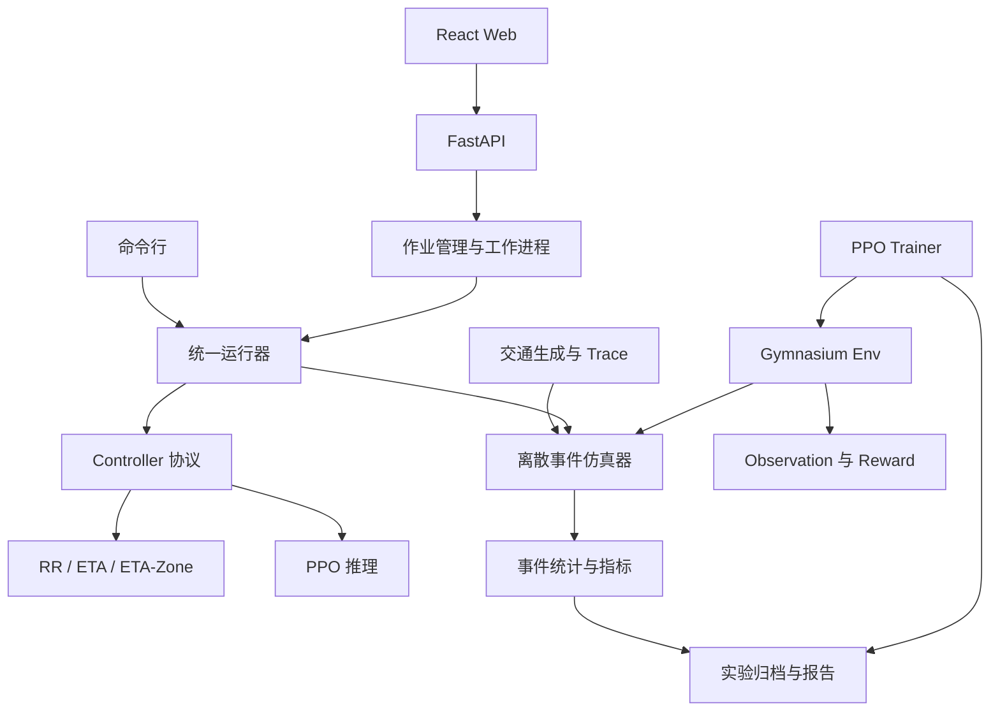

# 基于深度强化学习的多电梯智能群控系统——系统实施方案

> 版本：1.0　编制日期：2026-10-22  
> 需求依据：[基于深度强化学习的多电梯智能群控系统（进阶版）.md](./基于深度强化学习的多电梯智能群控系统（进阶版）.md)  
> 用途：作为后续开发 agent 从空项目实现、验证、训练、评估和交付系统的执行依据。本文中的命令、路径和接口是待实现的交付契约，不代表当前仓库已有这些能力。

阅读导航：先看第 1～3 节明确范围、架构与实体；第 4～7 节实现仿真和控制协议；第 8～11 节实现强化学习；第 12～17 节完成实验、存储、服务、界面和质量保证；第 18～22 节是开发阶段、命令契约与交付验收。

## 1. 建设目标与实现边界

### 1.1 最终交付目标

交付一个本地可运行、实验可复现的电梯群控仿真系统，打通以下完整链路：

```text
建筑与交通配置 → 可复现 Passenger Trace → 多电梯离散事件仿真
                                         ↓
                 统一控制接口：Round Robin / ETA / PPO
                                         ↓
                Dispatch 分配请求 + Reposition 空闲重定位
                                         ↓
                  数据归档 → 指标评价 → Web 展示与对比
                                         ↑
                     Gymnasium 环境 → PPO 训练与模型注册
```

最终版本必须同时满足：

1. 5～30 层、2～8 部电梯、每梯容量 6～20 人可配置；测试可使用更小的人工场景。
2. 支持 Normal、Morning Up-Peak、Evening Down-Peak、Inter-floor、Burst 五种交通模式及分时段组合。
3. 具备正确且确定性的乘客、电梯、开关门、上下客、任务队列与时间推进逻辑。
4. 实现 Round Robin、ETA，以及 Shared Elevator Encoder + Self-Attention + Global Conditioning + PPO。
5. PPO 的 Dispatch 和 Reposition 两个动作分支都真实参与采样、训练、推理和评价。
6. 提供配置、实时仿真、实验对比和训练结果查看页面。
7. 保存原始流、运行明细、指标、模型、训练日志及可重复运行的命令。
8. 完成多种客流下的基线比较、重定位消融和建筑配置泛化实验。

### 1.2 范围与业务假设

| 项目 | 本期约定 |
|---|---|
| 系统性质 | 研究与演示用软件仿真，不连接真实电梯控制器 |
| 决策层级 | 中央单智能体决定请求归属及空闲重定位；底层运动由确定性控制器完成 |
| 请求类型 | 目的层已知的 destination-control 模式；乘客到达时同时提供起点、终点 |
| 分配粒度 | 一名乘客对应一个请求；多人突发表示为多个请求 |
| 分配约束 | 请求分配一次后不跨梯改派；不能搭乘未分配给自己的电梯 |
| 服务范围 | 所有电梯服务所有楼层；单层大堂为 1F，无分区禁停、故障、检修 |
| 乘客行为 | 不取消、不弃乘；不模拟轮椅、群组绑定、超重和偏好 |
| 电梯参数 | 第一版同一建筑内同容量、同速度；数据结构保留逐梯参数扩展能力 |
| 初始状态 | 全部电梯位于大堂、空载、门关闭；可配置其他初始楼层，实验必须一致 |
| 物理简化 | 楼层等高，分段匀速，忽略加减速与真实机电系统；开关门、上下客有耗时 |
| 能耗含义 | 输出距离和能源代理指标，不把代理值标成真实 kWh |
| 部署形态 | 单机、单用户优先；无需云服务即可完成全部核心流程 |

以下属于后续扩展，不作为本期前置依赖：真实硬件接入、多智能体 RL、电梯故障、动态改派、多轿厢井道、真实能耗标定、在线训练、跨机器任务调度。

### 1.3 对需求文档中未定项的统一决策

| 未定项 | 本方案固定选择 | 原因 |
|---|---|---|
| 仿真推进方式 | 自建最小堆离散事件引擎 | 明确事件顺序、可复现且便于与决策事件结合 |
| 单梯停靠规则 | 保持已承诺顺序的可行 pickup/dropoff 插入 | 明确容量与先接后送约束，供所有策略共享 |
| 双动作组织 | 按事件类型交替产生一次 Dispatch 或一次 Reposition | 避免一次输出全部电梯联合动作导致动作空间膨胀 |
| Reposition 动作 | Stay / Lobby / Low / Middle / High | 固定动作维度适配不同楼层数 |
| 可变电梯数量 | 8 个槽位 padding + mask + 共享网络 | 在训练和推理中保持统一张量接口 |
| 可变楼层数量 | 30 个槽位 padding + 归一化楼层坐标 | 提供楼层空间分布信息与显式有效位 |
| PPO 实现 | PyTorch 自定义小型 PPO 与 rollout buffer | 直接支持事件间隔折扣、条件动作头及 mask |
| 推理策略 | 默认 masked argmax；训练使用 masked sampling | 保证评估可复现 |
| 仿真结束 | 到达窗口结束后停止生成，继续排空至完成或排空上限 | 防止只统计已完成乘客造成选择偏差 |
| 学习效果 | 定量实验验证，不预先保证必然超过 ETA | 区分工程完成和算法效果结论 |

本文是对原需求的工程细化。新增选择需要写入代码、测试和实验元数据；后续如修改，应先更新相应配置版本、接口版本和验收用例，不能在各模块分别采用不同解释。

## 2. 技术架构与工程组织

### 2.1 技术栈

| 层次 | 选择 | 使用范围 |
|---|---|---|
| 核心语言 | Python 3.11 | 仿真、交通、训练、评价、API |
| 配置与数据校验 | Pydantic 2、YAML/JSON | 配置解析、默认值、接口校验 |
| 数值与数据 | NumPy、pandas | 流生成、张量预处理、CSV 与评价 |
| 强化学习 | PyTorch 2、Gymnasium | 网络、PPO、自定义环境 |
| 后端 | FastAPI、Uvicorn | REST、WebSocket、静态站点托管 |
| 存储 | SQLite + 本地文件目录 | 作业元数据与大体量实验文件分离 |
| 前端 | React、TypeScript、Vite | 配置与交互页面 |
| 图形 | SVG + ECharts | 楼层/电梯动画、指标与实验曲线 |
| 测试 | pytest、Hypothesis、前端单测、Playwright | 仿真不变量、算法接口、端到端验收 |
| 工具 | uv、Ruff、类型检查、npm lockfile | 可复现依赖与质量检查 |

首次搭建时选择相互兼容的稳定版本，将 Python 补丁版本、Node 受支持的 LTS 版本和依赖精确版本锁定到 `.python-version`、`.node-version`、`uv.lock`、`package-lock.json`。以上是技术路线而非已经验证的版本组合；必须在阶段 P0 完成 CPU 安装与启动验证。

CPU 为功能验收必需环境；CUDA/MPS 是可选训练加速。设备由配置选择，不能因缺少 GPU 阻断基线、页面或小规模训练。

### 2.2 模块依赖约束



约束：

- `simulator` 不依赖 FastAPI、前端、PyTorch、数据库；可被纯 Python 测试独立驱动。
- 仿真器提供状态与决策请求，不在内部选择 RR/ETA/PPO。
- 所有入口复用同一个仿真器、路由规划器和指标计算器。
- 后端只负责管理作业和传输状态，不另写一套物理规则。
- 前端只插值呈现服务端状态，不计算真实位置、乘客完成状态或权威指标。
- 训练关闭高频轨迹落盘，保留必要统计；评价开启完整审计数据。

### 2.3 建议目录

```text
elevator-control-system/
├── 实施方案.md
├── README.md
├── pyproject.toml
├── uv.lock
├── .python-version
├── .node-version
├── .env.example
├── Makefile
├── configs/
│   ├── simulation/{demo,small,large}.yaml
│   ├── traffic/{normal,morning,evening,interfloor,burst,mixed}.yaml
│   ├── training/{smoke,curriculum,full}.yaml
│   └── evaluation/{smoke,standard,generalization,ablation}.yaml
├── src/elevator_control/
│   ├── config/           # schema、加载、校验、版本与哈希
│   ├── domain/           # dataclass、enum、单位和不可变 DTO
│   ├── traffic/          # 随机流、模式、trace 读写
│   ├── simulator/        # engine、events、local_controller、route_planner、eta
│   ├── controllers/      # 协议、round_robin、eta、eta_zone、rl_controller
│   ├── env/              # Gym 环境、观测、mask、奖励积分
│   ├── rl/               # 网络、buffer、PPO、训练、checkpoint
│   ├── evaluation/       # 指标、suite、统计、图表与报告
│   ├── storage/          # 目录归档、manifest、SQLite repository
│   ├── backend/          # app、routers、DTO、worker、manager、WebSocket
│   └── cli.py
├── frontend/
│   ├── src/{api,components,pages,state,types}/
│   ├── package.json
│   └── package-lock.json
├── tests/{unit,property,integration,e2e,fixtures}/
├── scripts/{bootstrap,run_demo,run_acceptance,benchmark}.*
├── docs/{architecture,simulator,training,evaluation,api,troubleshooting}.md
├── data/traces/          # 输入流，不含策略运行结果
├── artifacts/{runs,experiments,training,models}/
└── reports/
```

`artifacts/`、大规模 traces、虚拟环境和前端依赖应加入 `.gitignore`；小型人工 fixture、示例配置和验收报告索引可以纳入版本控制。

## 3. 配置、单位与领域模型

### 3.1 统一单位与编号

- 配置、API、CSV 均使用楼层 `1..F`；电梯公开 ID 为 `E1..EM`，网络槽位索引为 `0..M-1`。
- 内部时间采用整数微秒 `time_us`；外部单位为秒。随机到达时间和物理耗时统一量化一次，最小正物理耗时为 1 微秒。
- 位置 `position_floor` 可为小数；仅停站时有整数 `at_floor`。不能用四舍五入后的楼层决定是否能上下客。
- 默认速度使用 `seconds_per_floor`，若 UI 支持 m/s，须结合 `floor_height_m` 显式换算。
- `distance_floors` 是累计实际移动层数；`distance_m = distance_floors × floor_height_m`。
- 全部 ID、随机数流和事件 tie-break 规则确定；不使用系统当前时间作为仿真决策输入。

### 3.2 默认仿真配置

```yaml
schema_version: 1
seed: 42
building:
  floor_count: 12
  elevator_count: 4
  capacity: 12
  lobby_floor: 1
  floor_height_m: 3.0
  initial_floors: [1, 1, 1, 1]
physics:
  seconds_per_floor: 2.0
  door_open_s: 2.0
  door_close_s: 2.0
  board_s_per_person: 0.8
  alight_s_per_person: 0.8
simulation:
  arrival_horizon_s: 1800.0
  max_drain_s: 1800.0
  snapshot_interval_s: 1.0
  max_passengers: 100000
traffic:
  pattern: normal
  arrival_rate_per_min: 12.0
  segments: []
  bursts: []
controller:
  name: eta
  model_id: null
reposition:
  idle_review_s: 30.0
  cooldown_s: 30.0
metrics:
  long_wait_threshold_s: 60.0
reward:
  wait_weight: 1.0
  ride_weight: 0.2
  energy_weight: 0.05
  fairness_weight: 0.5
  passenger_scale: 10.0
  time_scale_s: 60.0
  distance_scale_floors: 10.0
  long_wait_threshold_s: 60.0
```

这些数值是初始工程默认值，不是经验证的最优超参数。速度、上下客、门时间均须为正；客流率允许为 0。UI 可给出常用范围，但后端必须独立完成全部验证。

校验要求：

- 建筑规模、初始楼层长度、速度、容量、时间窗口、随机种子类型合法。
- `arrival_horizon_s > 0`，`max_drain_s >= 0`；交通分段互不重叠并完整覆盖到达窗口。
- 起终点不同且在建筑范围内；Burst 时间位于到达窗口内。
- 加载输入 trace 时核对楼层上限、时间排序、ID 唯一性和 schema。
- `controller.name=ppo` 必须有兼容模型；缺失时给出明确错误。
- 超过数量或资源上限时拒绝创建作业；不得悄悄删掉乘客以维持运行。

### 3.3 核心实体

| 实体 | 必需字段 |
|---|---|
| `Passenger` | id、arrival_us、origin、destination、status、assigned_elevator、assigned_us、pickup_us、finish_us |
| `Elevator` | id、capacity、position、direction、phase、onboard_ids、route、active_stop、segment、reposition_target、next_reposition_allowed_us、route_version |
| `Stop` | floor、pickup_ids、dropoff_ids；仅包含确定的乘客 ID，不只保存一个楼层数字 |
| `MotionSegment` | from_floor、to_floor、start_us、end_us、purpose、generation |
| `FloorQueue` | floor、up_ids、down_ids；按 `(arrival_us, passenger_id)` 排序 |
| `Event` | time_us、priority、sequence_id、type、entity_id、generation、payload |
| `DecisionRequest` | decision_id、time_us、kind、passenger_id 或 subject_elevator_id、action_mask |
| `WorldState` | clock、building、elevators、已到达乘客、楼层队列、统计器、事件堆、当前微阶段 |
| `TrafficTrace` | trace_id、schema_version、generator_version、seed、config_hash、records、sha256 |

乘客生命周期：`NOT_ARRIVED → WAITING_UNASSIGNED → WAITING_ASSIGNED → ONBOARD → COMPLETED`。上下客动作期间额外保存操作标记，不引入重复乘客副本。请求是乘客运输需求的视图，无需建立另一套独立可变生命周期。

`pickup_time` 定义为登梯完成时间；`finish_time` 为离梯完成时间。因此开门和等待登梯计入等待时间，登梯完成至离梯完成计入乘梯时间。所有指标、奖励和 ETA 使用同一口径。

## 4. 动态乘客流与可复现输入

### 4.1 到达过程

1. 默认采用分段常数强度的 Poisson 到达过程，配置单位为人/分钟，计算时换算成人/秒。
2. 每个分段独立生成指数分布间隔；跨过该段结束时间后丢弃越界样本，从下一段重新生成。零强度分段不生成到达。
3. 根据当前分段的 OD 概率生成起终点；禁止起点等于终点。
4. Burst 在背景流上叠加明确人数，默认在给定时间窗内均匀采样到达时刻；窗口为 0 时允许同一时刻集中到达。
5. 稳定排序后按顺序分配 passenger ID；同一时间按生成源索引和源内序号排序，规则写入 generator_version。

### 4.2 交通模式定义

| 模式 | 默认 OD 规则 |
|---|---|
| Normal | 起点在全部楼层均匀分布，终点在其他楼层均匀分布 |
| Morning | 80% 为 `1 → 2..F`，20% 为非大堂楼层之间的请求 |
| Evening | 80% 为 `2..F → 1`，20% 为非大堂楼层之间的请求 |
| Inter-floor | 起终点均在 `2..F`，且不相同 |
| Burst | 指定起点、人数、时间窗和目的层分布，叠加可选背景模式 |

示例 Burst：在 900～960 秒，12F 增加 30 名乘客，80% 去大堂，其余去其他非起点楼层。组合流允许依次设置 morning、normal、evening 分段；测试配置不能仅改变标签而保持同一 OD。

### 4.3 随机性分离与防止未来信息泄漏

- 由根种子派生 `traffic_seed`、`environment_seed`、`policy_seed`、`training_seed`、`bootstrap_seed`，保存派生规则与具体值。
- Passenger Trace 在运行策略之前生成并固化；同一实验所有算法读取完全相同的字节内容及哈希。
- 仿真引擎可以访问未来到达事件，Controller/ObservationBuilder 只能接收截至当前时间已经公开的状态。
- 策略不得读取下一名乘客、未来 OD、未到达人数、预生成 trace 文件或 Burst 未来发生时间。
- 默认交通特征来源是最近 60 秒与 300 秒已发生的到达记录；可以使用公开的时钟信息，但不直接提供隐藏的模式标签或真实未来强度。
- 如将“已公告班次/会议时间表”作为特征，应另设实验配置并让所有策略获得相同信息；本期默认关闭。

`trace.csv` 仅含 `passenger_id,arrival_time,origin_floor,destination_floor`。分配、接送时间是输出结果，保存在每个 run 的 `passengers.csv`，禁止回写输入流。

## 5. 离散事件仿真器

### 5.1 时间推进与事件顺序

事件堆按 `(time_us, priority, sequence_id)` 排序，禁止按对象地址或集合迭代顺序打破平局。每次推进到下一时间戳前，先将等待、乘梯、距离、利用率等累计量积分到目标时间。

同一时间戳采用固定的微阶段：

1. 完成已排定的运动段、开关门、上下客等物理事件，更新状态。
2. 注入该时刻所有乘客到达，更新楼层队列和历史交通统计。
3. 按 `(arrival_us, passenger_id)` 逐个处理 Dispatch；一次分配立即更新路线，后续决策看到更新后的状态。
4. 为已有服务任务的电梯启动下一项本地动作；在此阶段冻结本次停站的上下客名单。
5. 对仍符合条件的电梯逐个发出 Reposition；每次处理前重新检查是否仍空闲。顺序固定为电梯 ID 升序。
6. 写出该时间戳的状态变化，继续下一时刻。周期快照可以读取插值位置，但不产生控制动作。

一次 `env.step()` 可以停在同一时间戳的下一项决策上，此时 `delta_t=0`，通常没有区间奖励。单个时间戳的决策数有界：每个新请求分配一次，每部电梯最多一次重定位决策。Stay 不得即时再次触发自身。

内部实现可拆分为“推进到决策屏障”和“提交动作”；不得在等待策略返回时继续修改该实例状态。API 暂停同样停在一致的屏障或完成的事件边界。

### 5.2 电梯运行状态机

```text
IDLE_CLOSED → MOVING → AT_FLOOR
AT_FLOOR → OPENING → ALIGHTING → BOARDING → CLOSING
CLOSING → MOVING / IDLE_CLOSED
IDLE_CLOSED → REPOSITIONING → IDLE_CLOSED
```

实现时 `phase` 描述物理阶段，`purpose=SERVICE|REPOSITION` 描述移动目的，避免把两者混成相互矛盾的枚举。方向只有移动或有明确后续方向时才为 UP/DOWN，否则为 IDLE。

物理规则：

- 每次移动到相邻楼层，耗时 `seconds_per_floor`，在楼层边界重新检查后续路线。
- 途经非停靠楼层不打开门；到达需服务楼层后先开门、再下客、再上客、最后关门。
- 上下客按乘客逐个完成，每人的耗时为对应配置值。一次停站的名单在服务开始时冻结。
- 同一停站下客先于上客，以便释放容量；上客名单内按到达时间和 ID 排序。
- 开门后新产生的请求不加入已经冻结的停站，可以在关门后形成同楼层的下一次停站。
- 不发生瞬移、楼层间开门、开门移动、容量超限、乘客出现在两部电梯等情况。
- 没有上下客任务的纯重定位到达无需开门。

### 5.3 路线插入与容量预留

本地控制采用确定性可行插入，不将停靠顺序交给 RL。每部电梯维护有序 `Stop[]`；一次分配需同时计划该乘客的 pickup 和 dropoff。

插入算法：

1. 提取不可修改的执行前缀：当前移动至相邻楼层的剩余段，或当前已冻结的开门/上下客/关门过程。
2. 计算该前缀完成时的位置、时间与预期载客集合，作为后续路线预测起点。
3. 枚举新 pickup 的插入槽位及其后的 dropoff 插入槽位；只可合并相邻同楼层停站，不能破坏先接后送。
4. 前向模拟每个候选：每站先下后上，所有时刻必须 `0 <= load <= capacity`，每人仅接一次送一次。
5. 对可行候选计算 `route_cost = new_pickup_delay_s + 0.2 × added_route_duration_s`，选择最小者；其中 pickup delay 是预计登梯完成时刻减当前时刻，added duration 是新旧路线全部完成所需时间之差；平局按 pickup 槽位、dropoff 槽位排序。
6. 返回 `RouteProposal`，含新路线、预计接人时间、结束时间、距离增量和 `base_route_version`。
7. 选定电梯后原子提交 proposal；版本变化则重算。未选中电梯不产生任何状态变更。

当前停站已冻结时禁止修改其名单。移动中的当前相邻楼层段不能取消或反转；到边界后才应用新路线。路线预测计入剩余运动、门操作、上下客与未来全部已承诺停站。

以上描述完整候选集合的逻辑；长路线按第 17.2 节固定规则缩减候选集合，所有策略使用相同参数。路线版本同时包含成本函数、候选裁剪与停站合并规则。

满载不代表该电梯不能接收未来请求，因此 Dispatch 不能直接屏蔽当前满载电梯。新请求可安排在已有乘客下梯之后；将完整 pickup/dropoff 对追加在路线末尾应始终是一个可行退路。该退路不存在时是仿真错误，不允许丢弃请求。

容量由完整路线预留保证。正常运行不应出现“到站但计划乘客无法上梯”；若出现，抛出不变量错误并保存诊断现场，不静默删乘客或更换规则。该设计以简单可靠为优先，后续可以增加 LOOK/SCAN 作为独立、明确版本的本地控制器。

### 5.4 ETA 计算

`estimate_pickup(elevator, passenger)` 使用上述同一插入算法，返回新乘客登梯完成时刻减当前时刻。ETA 包括所有物理耗时和容量限制，不是单纯楼层距离。

- 不考虑尚未到达或尚未分配的未来请求；这是预测假设，需在文档中注明。
- 同一决策中缓存每个候选电梯的 proposal，ETA baseline 直接提交选中 proposal。
- RL 也使用同样的 ETA 特征，并在选定后提交相同规划规则产生的 proposal。
- 缓存键至少包含 `decision_id`、`elevator_id`、`route_version`；不能复用已过时结果。
- 无后续到达的测试场景下，预测 pickup 时间必须与真实执行值一致。

### 5.5 重定位、抢占与防抖

电梯只有在空载、无已分配等待乘客、无服务路线、门已关闭、未处于移动段中时才允许发起重定位。

- 初始空闲、完成服务进入空闲、空闲复查到期时可以触发；复查周期和 cooldown 默认均为 30 秒。
- Stay 将下次可决策时间推迟，不原地反复调用模型。
- 重定位到达后同样遵守 cooldown；到达一个目标不立即再次选择另一个目标。
- 新请求优先；若分配给正在重定位的电梯，取消剩余重定位计划，在当前相邻楼层段完成后执行服务路线。
- 通过 `generation` 使已失效的未来事件成为 no-op；不能取消已累计的运动时间和距离。
- 多部电梯同时空闲时逐个决策，后一个决策能看到前一个已承诺的目标。
- 到达窗口结束后禁用新的重定位；取消尚未开始的重定位，已开始的运动段完成后停下。

### 5.6 结束与排空

到达窗口为 `[0,H)`，只接纳此区间产生的乘客。到达 `H` 后进入 drain：继续处理已经到达的乘客，不产生新的乘客和主动重定位。

- 自然终止：时间已达 H，所有乘客完成，所有进行中的物理过程已收尾。
- 排空截止：最迟运行至 `H + max_drain_s`；仍有乘客未完成时标记 `drain_timeout`，保存未完成状态。
- 防止卡死：非终态但事件堆为空、同时间戳无限循环、非法状态都属于错误，应失败并导出最后事件，不当作正常结束。
- `max_passengers`、wall-clock 超时和事件数保护是显式资源限制，触发时标记失败或外部截断，不输出假装完整的结果。

## 6. 控制器协议与传统基线

### 6.1 统一接口

```python
class Controller(Protocol):
    def reset(self, config: SimulationConfig, seed: int) -> None: ...
    def act(self, view: DecisionView) -> DecisionAction: ...
    def close(self) -> None: ...

class Simulator:
    def reset(self, config, trace) -> None: ...
    def advance_until_decision_or_end(self) -> DecisionRequest | EndState: ...
    def apply_action(self, decision_id, action) -> None: ...
    def snapshot(self) -> SimulationSnapshot: ...
```

`DecisionView` 是只读公开状态，包含当前请求/主体电梯、有效动作、当前交通统计和可读取的 ETA，不包含未来事件堆。每个 action 必须绑定当前 `decision_id`；过期和重复提交均不能再次作用于状态。

### 6.2 必需基线

| 策略 | Dispatch | Reposition |
|---|---|---|
| `round_robin` | 按电梯顺序轮转，每次有效分配后移动指针 | Stay |
| `eta` | 选择最早预计登梯完成的电梯，平局取最低 ID | Stay |
| `eta_zone` | 同 ETA | 根据过去到达的起点热度分布安排空闲电梯 |

前两项来自原需求；第三项作为本方案增加的强基线，用于判断 PPO 的收益是否只是来自“使用了重定位”。

`eta_zone` 的具体规则：以过去 300 秒各区起点人数作为权重，计算 `热度 / (已驻留或已向该区移动的空闲电梯数 + 1)`，选择分数最高的合法区域；无历史到达时 Stay；平局优先移动距离较短、再按区域固定顺序。使用与 PPO 相同的区域映射和 cooldown。

可额外提供 `nearest_distance` 作为演示，但报告中明确区分距离最近和 ETA，不能用弱化的距离算法冒充 ETA baseline。

## 7. 强化学习环境与决策协议

### 7.1 单智能体、事件驱动建模

中央群控是唯一 RL agent。仿真内部是事件驱动过程；相邻决策的实际时间间隔不固定，因此训练按半马尔可夫决策过程处理折扣。

策略使用可观测的聚合状态。由于隐藏未来交通以及对长队列做统计压缩，前馈网络看到的是近似状态，并非宣称完全可观测的严格 Markov 状态。第一版通过双时间窗交通统计缓解该问题；循环网络是后续扩展。

### 7.2 Gymnasium API

```python
reset(seed=None, options=None) -> (observation, info)
step(action: int) -> (observation, reward, terminated, truncated, info)
```

`reset()` 调用父类初始化种子，并将仿真推进到第一个决策。初始化时所有空闲电梯在 t=0 可产生重定位决策，避免丢失第一次动作前的成本。`step()` 执行当前决策，然后推进至下一个决策或结束，返回这段区间的成本与实际 `delta_t_s`。接口语义遵循 [Gymnasium Env 文档](https://gymnasium.farama.org/api/env/)。

`info` 至少包含：`decision_id`、`decision_kind`、`delta_t_s`、原始 reward 分项、当前计数、终止原因、最终状态（结束时）、必要诊断标记。

自然完成为 `terminated=True`；排空上限和外部采样上限为 `truncated=True`。截断保留可供价值网络读取的最终状态，不能拿 reset 后的新 episode 状态估计旧 episode 的尾值。对应原则参见 [Gymnasium 时间限制说明](https://gymnasium.farama.org/tutorials/gymnasium_basics/handling_time_limits/)。

训练中的 rollout 长度到达只结束采样批次，不自动终止仿真 episode。终态 observation 保留形状；终态不再采样动作，其全零 action mask 必须由训练器显式绕过。

### 7.3 统一离散动作空间

固定 `Discrete(13)`：

| 动作索引 | 含义 |
|---|---|
| 0～7 | 将当前请求分配给对应电梯槽位 |
| 8 | 当前主体电梯 Stay |
| 9 | 当前主体电梯去 Lobby |
| 10 | 当前主体电梯去 Low |
| 11 | 当前主体电梯去 Middle |
| 12 | 当前主体电梯去 High |

Dispatch 仅允许有效电梯槽位；Reposition 仅允许 8～12 中的合法目标。每个非终态决策至少有一个有效动作；不得先采样非法动作再用罚分“教会”模型。

区域映射：将 `2..F` 升序列表用确定性的 `array_split(..., 3)` 分成 Low、Middle、High；每区目标取该区列表的下中位数；Lobby=1；Stay=当前位置。默认范围下每区非空。目标与当前楼层重合、目标重复时，只保留最前一个等价动作，Stay 优先。区域目标与动作含义写入模型 metadata。

### 7.4 动作 mask 的一致性

- 环境生成 mask；策略采样、old log-prob、PPO 更新、entropy、推理都使用同一份 mask。
- rollout 保存采样时的 mask，更新时不能用后来环境的状态重新计算。
- 屏蔽无效 logits 后构建 Categorical；无效槽位概率必须为 0。
- 当前满载电梯仍可承接未来请求；padding 电梯才必须屏蔽。
- 训练时非法 action 立即报错；Web 推理异常允许整次运行明确标记降级为 ETA，且必须记录降级次数，不能将降级结果冒充纯 PPO。

## 8. 观测设计与特征规范

### 8.1 张量契约

使用 `gymnasium.spaces.Dict`。以下形状不含 batch 维，`float32` 为默认浮点类型，mask 使用 bool。所有特征在 `FeatureSpec` 注册表中固定名称、顺序、单位、缩放方式，模型保存 `observation_version`。

| 键 | 形状 | 含义 |
|---|---|---|
| `elevators` | `[8,24]` | 每梯基础状态 |
| `elevator_routes` | `[8,30,8]` | 各梯按楼层聚合的待停靠信息 |
| `floors` | `[30,9]` | 楼层等待分布和近期需求 |
| `request` | `[5]` | 当前 Dispatch 请求；Reposition 时清零 |
| `global` | `[20]` | 建筑与交通上下文 |
| `decision_kind` | `[2]` | Dispatch / Reposition one-hot |
| `elevator_mask` | `[8]` | True 表示真实电梯 |
| `floor_mask` | `[30]` | True 表示真实楼层 |
| `action_mask` | `[13]` | True 表示允许采取的动作 |

### 8.2 单电梯 24 个基础特征

顺序固定如下：

1. 连续位置 `(position_floor-1)/(F-1)`。
2. 方向 `-1/0/+1`。
3. 载客率 `load/capacity`。
4. 容量 `capacity/20`。
5. 单层运行时间 `/10s`。
6. 当前原子物理动作剩余时间 `/60s`。
7. 是否空闲。
8. 是否执行重定位。
9. 是否开门中。
10. 是否关门中。
11. 是否门已开且处于上下客阶段。
12. 是否移动中。
13. 已分配但未上梯人数，经计数变换。
14. 已上梯人数 `/20`。
15. 待停站数量，经计数变换。
16. 下一目标楼层的归一化位置。
17. 下一目标是否存在。
18. 重定位目标楼层的归一化位置。
19. 重定位目标是否存在。
20. 当前请求 ETA `/300s`。
21. ETA 是否有效；Reposition 时为 0，ETA 值亦为 0。
22. 当前连续空闲时长 `/300s`。
23. 重定位冷却剩余时间 `/30s`。
24. 是否为本次 Reposition 的主体电梯。

### 8.3 路线、楼层和请求特征

`elevator_routes[e,f]` 的 8 个特征：归一化楼层、该层是否存在待停站、待接上行人数、待接下行人数、待送达人数、第一次预计到站时间 `/300s`、第一次停靠序位的计数变换、该层待访问次数的计数变换。

路线 ETA 是当前既定路线的预测；同楼层多次访问通过第一次到达和访问次数表达。此表是路线的压缩表示，不向网络提供无限长任务列表。

`floors[f]` 的 9 个特征：归一化楼层、上行等待人数、下行等待人数、上行最大已等待时间 `/300s`、下行最大已等待时间 `/300s`、最近 60 秒起点人数、最近 60 秒目的地人数、当前停驻电梯数量 `/8`、正在前往该楼层的重定位电梯数量 `/8`。人数使用同一种计数变换；没有等待者时对应最大等待为 0。

`request` 的 5 个特征：归一化起点、归一化终点、方向、已等待时间 `/300s`、请求有效标志。

### 8.4 全局 20 个特征

依次为：楼层数 `/30`、电梯数 `/8`、总容量 `/160`、总等待人数、最大已等待时间 `/300s`、总在梯人数 `/160`、空闲电梯比例、平均载客率、最近 60 秒到达率、最近 300 秒到达率、最近 60 秒大堂起点比例、大堂终点比例、上行请求比例、日内时刻 sin、日内时刻 cos、到达窗口剩余时间比例、是否 drain、当前平均已等待时间 `/300s`、开门状态电梯比例、重定位电梯比例。

没有历史样本时各 OD 比例为 0，历史到达率按实际覆盖时长计算并使用正的最小分母。仿真日内起始时刻由配置 `start_time_of_day_s` 给定，默认 08:00；不可从宿主机器时间读取。

缩放原则：

- 所有计数默认使用 `log1p(count)/log1p(100)`，不按本次 trace 的未来总人数归一化。
- 到达率统一换算为人/分钟后使用 `log1p(rate)/log1p(60)`。
- 预定 `[0,1]` 比例保持原值；时间、人数变换允许超过 1，统一裁剪到 `[0,10]` 并记录裁剪比例。
- 方向和三角函数允许负数。missing 值通过独立标志表达，不使用 NaN。
- padding 全零；真实大堂位置可以为 0，所以必须保留 mask。
- 第一版使用固定缩放，不在评估期间更新归一化统计量。

## 9. 神经网络设计

### 9.1 网络前向结构

设 batch size 为 B：

```text
elevator_routes [B,8,30,8]
  → 共享楼层 MLP(8→32→32)
  → 按 floor_mask 做 mean + max pooling [B,8,64]

concat(elevators [B,8,24], route_summary [B,8,64])
  → Shared Elevator Encoder(88→128→128) [B,8,128]
  → 2 层 Self-Attention Block，4 heads，hidden=128，FFN=256
  → H [B,8,128]

floors [B,30,9]
  → 共享 Floor MLP(9→32→32)
  → masked mean + max pooling [B,64]

request [B,5] → Request MLP(5→32→32) → R [B,32]
concat(global [B,20], floor_summary [B,64], kind [B,2])
  → Global MLP(86→64→64) → G [B,64]
context = concat(R,G) [B,96]

Dispatch：共享 Scorer(concat(H_i,context), 224→128→1) → [B,8]
Reposition：concat(H_subject, mean(H), context), 352→128→5 → [B,5]
Value：concat(mean(H), max(H), context), 352→128→1 → [B,1]

concat(dispatch_logits, reposition_logits) [B,13]
  → action_mask → Categorical
```

MLP 使用 SiLU；Attention Block 使用 residual、LayerNorm，dropout=0。actor 与 critic 共享状态编码器，保留独立输出层。Reposition subject 通过主体标志选择；Dispatch 时该向量置零，未激活的动作头不参与该样本的策略分布。

Self-Attention 不使用电梯编号 embedding 或绝对槽位 positional embedding；楼层坐标属于物理特征，应保留。PyTorch 的 `key_padding_mask=True` 表示忽略，因此传入 `~elevator_mask`，与本文有效位约定正好相反。详见 [PyTorch MultiheadAttention](https://docs.pytorch.org/docs/stable/generated/torch.nn.MultiheadAttention.html)。

每个 Attention Block 后重新将 padding 行清零；mean/max pooling 都应用 mask。无效元素在 max pooling 中用足够小值排除，而不是用 0 参与最大值。

### 9.2 模型必须验证的性质

- 2、4、8 部电梯以及 5、12、30 层均能通过前向、采样、反向和保存加载。
- 同步置换电梯输入、route、mask、subject 后，Dispatch 概率按同一置换变化，Value 保持不变；Reposition 输出保持不变，允许浮点误差。
- 改变 padding 区域内容不影响有效输出；无效动作概率为零。
- 改变其他真实电梯状态能够影响当前电梯的表示，证明 Attention 已接入计算图。
- actor 两个动作头和共享编码器有非零、有限梯度；Attention 热力图只能作为解释辅助，不能替代效果实验。

## 10. 奖励设计与事件间隔积分

### 10.1 奖励成本定义

每次动作后，到下一决策或终止的区间为 `[t_k,t_{k+1}]`。以事件边界拆分积分，记录四个非负成本：

\[
C^W_k=\int_{t_k}^{t_{k+1}}N_{waiting}(u)\,du,\qquad
C^R_k=\int_{t_k}^{t_{k+1}}N_{onboard}(u)\,du.
\]

`WAITING_UNASSIGNED`、`WAITING_ASSIGNED` 和正在登梯但尚未登梯完成的乘客都计入 waiting；已登梯到离梯完成计入 onboard。区间内先积分旧状态，再执行事件更新，防止把整个区间错误地套用到更新后人数。

能源代理：

\[
C^E_k=\Delta D_{empty}+1.3\Delta D_{loaded}
       +0.2\Delta N_{door\_cycles}+0.1\Delta N_{starts}.
\]

距离单位为层，loaded 表示移动时至少有一名在梯乘客；一次连续移动从静止开始计一个 start，不是每经过一层都重新计数。门循环在一次开门开始时计数。系数是显式可配置的相对权重，不具有实测物理单位。

公平性定义为每名乘客等待年龄超过阈值后的平方超时成本。令：

\[
q(w)=\max(0,(w-\tau)/T_0)^2,\qquad \tau=60s.
\]

每个子区间，对仍在等待的乘客累计 `q(w_end)-q(w_start)`；乘客在区间内上梯时计算到其 pickup 时刻为止。把这些正增量相加得到 `C^F_k`。上梯移出等待集合时不减掉已累计惩罚，因此一次完整运行的总公平性成本为各乘客最终等待超时平方之和。

公平性可逐人验证，优化时使用等待年龄的一阶/二阶统计并单独处理阈值跨越；必须先有参考实现。不要每个事件重复扣减完整平方值，否则奖励会随事件数量改变。

### 10.2 组合与归一化

\[
r_k=-\left[
\alpha\frac{C^W_k}{P_0T_0}
+\beta\frac{C^R_k}{P_0T_0}
+\gamma_E\frac{C^E_k}{D_0}
+\delta\frac{C^F_k}{P_0}
\right].
\]

默认 `P0=10`、`T0=60s`、`D0=10`，权重分别为 `1.0,0.2,0.05,0.5`。能源权重使用 `gamma_E`，与 PPO 折扣 gamma 区分。

- 不按已完成乘客数归一化，避免策略通过拖延完成改变分母。
- 不增加“重定位成功奖励”或“每次分配奖励”，避免无效动作刷奖励。
- 初始版不裁剪最终奖励；监测分项分位数，必要时调整固定尺度并建立新 reward_version。
- 报表保存未归一化成本和最终权重，支持解释优化方向。
- 奖励是上述区间成本之和；时间折扣应用于区间之间，这是本项目明确选择的 SMDP 目标。不得把它描述为区间内部也精确做了连续时间折扣。

必须用守恒关系验证：完整排空时 `ΣC_W = Σwaiting_time`、`ΣC_R = Σtravel_time`；截断时等于已完成部分加尚未结束乘客截至截止时间的累计部分。

## 11. PPO 训练实现

### 11.1 训练器与 buffer

自定义最小 PPO，不另外重写通用深度学习框架。核心依据为 [PPO 原始论文](https://arxiv.org/abs/1707.06347) 的 clipped surrogate objective；优势估计采用 [GAE 论文](https://arxiv.org/abs/1506.02438) 的思想，加入本文定义的实际时间间隔系数。

每个 transition 保存：

```text
obs, action_mask, decision_kind, action, old_log_prob, old_value,
reward, reward_components, delta_t_s, terminated, truncated,
next_value/final_observation, episode_id, environment_id
```

采样时 `no_grad()`，更新时重新计算当前分布；`old_log_prob` 和 return 不参与梯度。环境各自维护独立 episode 边界，不能将不同实例或 reset 前后的 transition 串在一起。

### 11.2 时间折扣与 GAE

默认参考间隔 `dt_ref=10s`，`gamma_ref=0.99`，`lambda_ref=0.95`：

\[
\Gamma_k=\gamma_{ref}^{\Delta t_k/dt_{ref}},\qquad
\Lambda_k=\lambda_{ref}^{\Delta t_k/dt_{ref}}.
\]

\[
\delta_k=r_k+\Gamma_k b_k V(s_{k+1})-V(s_k),
\qquad
\hat A_k=\delta_k+\Gamma_k\Lambda_k c_k\hat A_{k+1}.
\]

- `b=0` 仅用于自然终止，外部截断通常为 1 并使用最终 observation 的 Value。
- `c=0` 用于所有 episode 边界及采样批次尾部，阻止 GAE 穿越 reset；批次尾部仍通过 next_value 做 bootstrap。
- 同时间戳的连续动作 `delta_t=0`，`Gamma=Lambda=1`，不得人为增加仿真时间。
- `return = advantage + old_value`；仅对参与更新的有效样本标准化 advantage。

排空上限的处理必须一致：环境报告截断；训练优先选择能完整排空的负载与上限。若截断发生在无决策的物理时刻，保留真实全局观测，并以空 request、空 subject、全零 decision_kind 构造尾值观测，critic 接口允许该状态；其估计属于近似，应单独统计。高截断率时调整场景和排空预算，不能把存在大量未知尾值的训练当作稳定结果。

不得直接套用固定 `gamma` 的常规 PPO buffer 后声称实现了实际时间折扣。对 `delta_t=0`、不同间隔、终止、截断和批次尾部都需手算测试。

### 11.3 损失与默认参数

\[
\rho_k=\exp(\log\pi_\theta(a_k|s_k)-\log\pi_{old}(a_k|s_k)),
\]

\[
L_{policy}=-\mathbb E[\min(\rho_k\hat A_k,
\operatorname{clip}(\rho_k,1-\epsilon,1+\epsilon)\hat A_k)],
\]

\[
L=L_{policy}+c_v\operatorname{MSE}(V,return)-c_H H(\pi).
\]

| 参数 | 初始值 |
|---|---|
| 并行环境数 | CPU 默认 4，smoke 为 1 |
| 每环境每批决策数 | 512，总 batch 默认 2048 |
| minibatch | 256 |
| PPO epochs | 4 |
| 学习率 | 3e-4，按总训练进度线性衰减到 3e-5 |
| clip epsilon | 0.2 |
| value coefficient | 0.5 |
| entropy coefficient | 0.01 |
| max gradient norm | 0.5 |
| target KL | 0.02，超过 1.5 倍时停止当前 update 的后续 epoch |
| 优化器 | Adam，eps=1e-5 |
| 验证间隔 | 每 20 个 update |
| checkpoint 间隔 | 每 20 个 update，并保存 best 与 last |

记录 active head entropy；另分别记录 Dispatch/Reposition 的 entropy、样本数和梯度。初始按原始事件分布训练，不偷偷对某一头过采样；如果 Reposition 样本不足，先检查事件触发和训练场景中的空闲比例。

### 11.4 训练课程

| 阶段 | 环境与任务 | 建议决策预算 | 进入下一阶段的条件 |
|---|---|---:|---|
| T0 smoke | 5 层 2 梯，低流量，两类动作均启用 | 1 万 | loss/梯度有限，保存加载一致，无不变量错误 |
| T1 固定配置 | 8 层 3 梯，Normal，先限制 Reposition=Stay | 20 万 | 调度可完成、相对初始模型出现可重复的学习信号 |
| T2 双任务 | 8～12 层、2～4 梯，Morning/Evening/Normal | 80 万 | 两头均训练，重定位次数与距离可解释 |
| T3 域随机化 | 5～20 层、2～6 梯，多流量、五模式 | 200 万起 | 验证集稳定，无明显崩溃，保存最佳模型 |
| T4 正式实验 | 固定训练配置，至少 3 个训练 seed | 根据资源登记 | 报告多 seed 与独立测试结果 |

预算为初始实验计划，不是对收敛或耗时的保证；训练器允许续训和覆盖。CPU 能完成 T0/T1，完整实验耗时需在 P6 的 benchmark 中实测后填写。

训练域随机化：在 episode reset 时抽样楼层、电梯数、容量（6/12/20）、速度（1.5～3 秒/层）、模式和流量；严禁在同一 episode 中改变建筑结构。以 `arrival_rate_per_min = elevator_count × {1,3,5}` 作为起始低/中/高负载级别，并通过 ETA 的积压与排空情况校准，不能把这一经验尺度称为真实系统利用率。

### 11.5 验证、选择模型与续训

- train 使用不断变化但可追溯的种子；validation 使用固定且不重叠的配置/trace；test 在调参完成后运行。
- 所有模型选择先检查完整服务率和数值正确性，再以验证集加权平均总成本排序，平局比较 P95。
- 同时保存 `best.pt` 与 `last.pt`；不要按训练 reward 的单次峰值选择模型。
- checkpoint 包含网络、optimizer、scheduler、步数、各 RNG 状态、配置、feature/reward/route 版本、依赖版本和训练数据 manifest。
- 默认在 update 边界保存；恢复时舍弃未保存 rollout 并重新 reset 环境，明确标记为统计可复现续训。若要求逐位延续，额外保存全部仿真状态、事件堆、rollout 和 worker RNG。
- 推理加载仅使用受信任的本地产物、网络权重及元数据，不允许用户上传任意可执行序列化对象。
- 记录 PyTorch 与设备版本；相同种子不能保证跨平台逐位一致，按 [PyTorch 可复现性说明](https://docs.pytorch.org/docs/stable/notes/randomness.html) 配置确定性选项并报告限制。

## 12. 指标口径与实验评价

### 12.1 必需指标

设原始到达窗口长度为 H；有效 cohort 为所有 `arrival_time ∈ [0,H)` 的乘客，排空期间不新增 cohort。

| 指标 | 定义与输出要求 |
|---|---|
| MeanWait | 已接到乘客的 `pickup-arrival` 均值；未全部接到时明确标记条件统计 |
| P95Wait | 同一等待样本集合，NumPy `method=linear` 的 95% 分位数 |
| MaxWait | 同一等待样本集合的最大值 |
| MeanTravel | 已送达乘客的 `finish-pickup` 均值 |
| MeanSystemTime | 已送达乘客的 `finish-arrival` 均值 |
| LongWaitRatio | 已接到乘客中 `waiting_time > 60s` 的比例，标明分母 |
| Throughput | 到达窗口内完成服务人数 / `(H/60)`，单位人/分钟 |
| CompletionRatioH | H 时刻已完成人数 / cohort 总人数 |
| FinalCompletionRatio | run 结束时已完成人数 / cohort 总人数 |
| Unpicked / Unfinished | 未接到人数、未送达人数分别记录 |
| TotalDistance | 所有电梯实际累计移动层数与米数，含重定位 |
| RepositionDistance | 运动目的为重定位时的实际距离；抢占前已发生距离仍计入 |
| EnergyProxy | 第 10 节定义的代理量，并输出组成项 |
| Utilization | 每梯非空闲时间 / 实际运行时间，另列服务、重定位、开门占比 |
| DrainTime | H 后实际清空耗时；超时另有标志 |
| FloorFairness | 各起点楼层 mean/P95/count、最差楼层均值；无样本楼层为 null |

可增加等待时间 Gini，但不能用“电梯工作量均匀”替代乘客服务公平性。

### 12.2 未完成、空样本和时间窗处理

- `metrics.json` 分别提供 `at_horizon` 和 `final` 两组；总距离、能耗等同时提供运行窗口值和含 drain 值。
- drain 全部完成时，可比较完整 cohort 的最终等待/乘梯分布。
- 若仍有未接到乘客，额外输出 `censored_mean_wait_lower_bound`：已知完整等待与未接到乘客截至结束的等待年龄合计后除 cohort 总人数。
- 长等待比例另给全 cohort 下界：已确认等待超阈值的人数 / 总人数；尚不能确定的未接到者保留未知标记。
- 不完整 run 的条件 MeanWait/P95 不进入“最佳算法”排序；展示未完成率与下界，并扩大 drain 或单独报告过载实验。
- 平均值、分位数在无有效样本时为 JSON `null`，前端显示“暂无样本”，不伪造为 0。
- 零乘客 trace 的完成率约定为 1，并附 `sample_count=0`；统计比较排除该空样本，运行本身应正常完成。
- 实时 MeanWait/P95 基于已经 pickup 的样本，必须标“已接到”；同时显示当前等待人数、最长已等待和已完成数。

### 12.3 配对比较与实验隔离

每个 scenario 保存以下不可变 manifest：建筑参数、物理参数、起始状态、H、drain、trace 哈希、环境版本、路由规则、指标阈值、策略配置和模型哈希。

同一 scenario 下只改变 controller；速度倍率、浏览器刷新频率和是否开启 UI 不得改变仿真结果。比较程序核对所有公共项，发现不一致即拒绝直接合并。

每个配置至少 20 条独立测试 trace；同一 trace 上比较各策略，形成配对差值。输出逐 trace 原始指标、跨 trace 均值/中位数，以及按 trace 进行 2,000 次配对 bootstrap 的 95% 区间。统计单位是 trace，而不是将同一 trace 内相关的乘客当作独立样本。

PPO 至少 3 个独立训练 seed，分别对相同测试 traces 评价；先报告每个训练 seed 的配对区间，再报告跨训练 seed 的均值与范围。若做合并区间，采用先抽模型 seed、再抽 trace 的分层 bootstrap，并注明样本量有限。

### 12.4 标准实验矩阵

| 实验 | 建筑 | 交通 | 策略 | 最小重复 |
|---|---|---|---|---|
| 开发 smoke | 5F2E、8F3E | Normal + 小 Burst | RR、ETA、PPO | 各 2 traces |
| 标准比较 | 8F3E、12F4E、20F6E | 五模式 × 低/中/高负载 | RR、ETA、ETA-Zone、PPO | 每格 20 traces |
| 组合流 | 12F4E | morning→normal→evening | 上述四策略 | 20 traces |
| 插值泛化 | 12F3E、18F5E | 五模式，中负载 | ETA、PPO | 每格 20 traces |
| 外推泛化 | 24F7E、30F8E | 五模式，低/中负载 | ETA、PPO | 每格 20 traces |
| 极端压力 | 30F8E | 高频到达、集中 Burst | 至少 RR、ETA、PPO | 5 traces，检查稳定性 |

插值泛化的两个建筑组合必须从训练与 validation 的配置采样器中明确排除；不能先在全范围随机训练后称某个组合“未见”。外推配置超出训练建筑范围但不超出 30F/8E 输入上限；同一 checkpoint 直接评估，不再训练。

矩阵较大时支持分片、缓存成功 run 和断点续跑。每次发布 report 声明实际完成的矩阵和缺失项，不把 smoke 结果当作正式效果验证。

### 12.5 消融与效果标准

必要消融：

1. 完整 PPO 与强制 Reposition=Stay 的推理干预，直接观察该模型对重定位的依赖。
2. 单独重新训练 Dispatch-only PPO，区分策略适配与直接禁用动作的影响。
3. 去掉 Self-Attention 的共享编码器 PPO，其他输入和训练预算保持一致。
4. 去掉公平性权重，观察 P95、最大等待和长等待比例的变化。

可选：固定 padding 展平的 MLP PPO、去掉全局交通特征、不同奖励权重的效率—能耗权衡。消融应报告参数量、训练预算和 seed，不能改变多项因素后只归因于 Attention。

研究目标建议设为：中负载场景相对 ETA 的 MeanWait 改善 5% 以上，同时 P95 与总距离恶化不超过 5%，且服务完整。此值是待验证目标，不是原需求已有承诺；未达到时系统仍应交付真实结果与分析，不修改 trace 或选择性隐藏差场景。最终分别判定“软件验收通过”和“效果目标达到/未达到”。

## 13. 数据持久化、产物与版本

### 13.1 单次仿真目录

```text
artifacts/runs/<run_id>/
├── config.json                 # 已展开默认值的完整配置
├── manifest.json               # 版本、哈希、trace_id、模型、状态、环境
├── input_trace.csv             # 输入流副本或不可变内容寻址引用
├── passengers.csv              # 全体 cohort，一人一行，未完成字段留空
├── elevator_trace.csv          # 固定仿真时间采样与关键状态变化
├── decisions.jsonl             # 决策类型、动作、主体、mask、推理耗时
├── events.jsonl                # 可选完整事件审计；评价默认启用
├── metrics_timeseries.csv      # 固定仿真时间间隔的指标
├── metrics.json                # at_horizon、final、样本数与口径
├── run.log
└── failure.json                # 仅失败时，最近事件和不变量上下文
```

`passengers.csv` 至少包含原需求全部字段，并补充 `status,assigned_time,system_time,censored_wait_age`。`elevator_trace.csv` 包含 `timestamp,elevator_id,position_floor,at_floor,direction,load,target,phase,purpose,distance_floors`。

初始 t=0、H、最终时间都必须能取得快照。固定时间采样不能只在恰好存在物理事件时发生；通过采样事件或只读插值补齐，且不改变路由、随机流和控制触发。

### 13.2 训练、模型与实验目录

```text
artifacts/training/<training_id>/
  config.json, split_manifest.json, progress.json, updates.csv,
  validation.csv, checkpoints/{best,last}.pt, training.log

artifacts/models/<model_id>/
  weights.pt, metadata.json, validation_metrics.json

artifacts/experiments/<experiment_id>/
  suite.yaml, manifest.json, runs.csv, summary.csv,
  paired_differences.csv, confidence_intervals.csv,
  figures/, report.md
```

`updates.csv` 包括 step、仿真秒数、episode 数、reward 分项、policy/value loss、KL、clip fraction、explained variance、两头 entropy、梯度 norm、采样/训练吞吐、失败/截断率。图表由真实 CSV 生成，不能使用固定伪曲线。

模型 metadata 至少包含：模型 ID、文件 SHA256、网络超参数、输入/动作/区域/reward/路由版本、支持上限、训练域范围、软件版本、选模依据和种子。模型适配检查同时核对输入形状与语义版本；仅“能加载权重”不足以证明兼容。

### 13.3 存储一致性

- SQLite 只存 run、experiment、model、command 的索引、状态与产物相对路径；使用 WAL，索引由 API 或 CLI 的协调进程通过同一 repository 和事务写入，计算 worker 不直接写索引。
- worker 写独立 run 目录；大文件流式追加，最终 JSON/manifest 先写临时文件再原子替换。
- 状态从运行中到完成，必须在产物落盘成功后提交。失败保留部分产物并标明不完整。
- 配置哈希采用规范化 JSON；忽略 run_id、创建时间等非语义字段。
- 复用缓存依据 `trace_hash + physics/config_hash + controller/model_hash + simulator_version`，不能仅按 seed 命中。
- 所有下载通过产物 ID 和白名单解析；禁止把用户输入直接拼接成本地任意路径。

## 14. 后端服务与作业执行

### 14.1 进程模型

FastAPI 主进程处理 HTTP/WebSocket，独立工作进程运行仿真/评价。训练默认使用 CLI 独立进程，Web 读取注册后的训练目录和曲线。

- 初版一个 API worker；不要启用多个 Uvicorn worker 却仍使用进程内作业表。
- 默认最多 2 个仿真工作进程和 1 个训练进程，超出进入队列；配置可改。
- 使用跨平台 `multiprocessing` 的 spawn 模式，入口有 main guard；不要依赖 fork 继承模型或锁。
- 控制命令用有序队列，快照用有界队列；旧快照可覆盖，控制确认和终态不可丢失。
- 每处理一定数量事件或达到约 20ms wall time 检查命令；不能因无下一个策略决策而长时间忽略暂停。
- 仿真可暂停在物理事件边界，保留本次决策到当前时刻的奖励积分，不丢失未返回给训练环境的成本。
- 服务重启时未完成进程标记为 interrupted/FAILED，已有结果仍可查阅；本期不要求服务器重启后自动恢复实时仿真。

### 14.2 作业状态和控制

运行状态：`CREATED → QUEUED → RUNNING ↔ PAUSED → COMPLETED`，以及 `STOPPED/FAILED` 终态。

- Start：创建后的实例入队并开始运行。
- Pause：API 返回命令已接受，worker 在一致边界确认后才显示 PAUSED。
- Resume：从当前状态继续，不 reset 时间和随机数流。
- Stop：结束执行并保存部分结果，未完成指标按截断口径显示。
- Reset：终止旧运行并保留产物，用相同配置与输入 trace 创建新的 run_id，返回 `new_run_id`；不能覆盖旧实验。
- 同一 `command_id` 重试只执行一次；非法状态切换返回 409。
- 墙钟速度倍率只控制事件推进节奏；可选 1×/5×/20×/最快，不改变仿真时间公式。

### 14.3 REST 接口契约

统一前缀 `/api/v1`，响应带 schema 版本。以下为必须实现的最小接口：

| 方法与路径 | 请求或功能 | 关键返回 |
|---|---|---|
| `GET /health` | 服务及 worker 状态 | version、ready |
| `GET /config/defaults` | 默认值、允许范围、策略列表 | config、schema |
| `POST /config/validate` | 校验完整配置 | normalized_config、field_errors |
| `POST /traces` | 生成或导入合法 trace | trace_id、hash、人数、范围 |
| `GET /traces/{id}` | 查看 trace 元数据 | manifest |
| `POST /simulations` | config、trace_id 可选、controller | run_id、status、ws_url |
| `GET /simulations` | 分页查询历史 | items、cursor |
| `GET /simulations/{id}` | 运行状态和配置 | status、progress、manifest |
| `GET /simulations/{id}/snapshot` | 当前完整快照 | snapshot |
| `POST /simulations/{id}/commands` | command_id、type、payload | accepted、command_id；reset 的新 ID |
| `GET /simulations/{id}/metrics` | 当前或最终指标 | metrics、sample_counts |
| `GET /simulations/{id}/passengers` | 分页、按状态/楼层过滤 | items、cursor |
| `GET /simulations/{id}/artifacts` | 可下载产物列表 | artifact IDs |
| `GET /artifacts/{id}` | 下载已登记文件 | 文件流 |
| `POST /experiments` | suite 配置、策略与模型列表 | experiment_id、status |
| `GET /experiments/{id}` | 批量进度 | completed/total、failed |
| `GET /experiments/{id}/results` | 可比结果和区间 | tables、series、warnings |
| `GET /models` | 已注册模型 | metadata 与兼容性 |
| `GET /training-runs` | 已登记训练任务 | progress、状态 |
| `GET /training-runs/{id}/curves` | 读取训练/验证曲线 | 有界采样后的 series |

创建请求示例：

```json
{
  "config": {"schema_version": 1, "seed": 42, "building": {"floor_count": 12, "elevator_count": 4, "capacity": 12}},
  "trace_id": "trace-example",
  "controller": {"name": "ppo", "model_id": "ppo-example"}
}
```

示例省略的字段按已公开默认值补全，后端返回完整规范化配置。用户选用已有 trace 时，若请求中交通配置与 trace manifest 不一致，应拒绝或要求调用者明确以 trace 为准，不能默默重新生成。

错误结构统一为 `{code,message,details,request_id}`；400/422 表示配置或模型不兼容，404 表示 ID 不存在，409 表示状态冲突，429 表示资源额度不足。错误消息中指出具体字段，不把完整 Python traceback 显示给终端用户。

### 14.4 WebSocket 协议

连接 `/ws/v1/simulations/{run_id}`，只用于状态推送，控制命令统一走 REST。FastAPI 支持 WebSocket 与断开处理，连接层实现参考其[官方文档](https://fastapi.tiangolo.com/advanced/websockets/)。

```json
{
  "schema_version": 1,
  "type": "snapshot",
  "run_id": "run-example",
  "sequence": 123,
  "sim_time_s": 120.5,
  "status": "RUNNING",
  "speed_multiplier": 5,
  "elevators": [
    {"id": "E1", "position_floor": 4.25, "direction": "UP", "load": 5,
     "capacity": 12, "target_floor": 8, "phase": "MOVING", "purpose": "SERVICE"}
  ],
  "floor_queues": [{"floor": 4, "up_count": 2, "down_count": 1, "max_wait_s": 24.0}],
  "metrics": {"picked_count": 20, "mean_wait_picked_s": 18.4, "waiting_count": 9}
}
```

上述为单条结构示例，真实快照包含全部有效电梯和楼层。移动项另提供 segment 起终点、起止仿真时间，以供前端插值。

- 默认最多每秒推送 10 次 wall-clock 快照；加速运行不按每个内部事件发送。
- 每次连接先发完整快照；第一版持续发送完整快照即可，不必实现复杂增量补丁。
- sequence 单调递增，前端忽略过期消息；断线自动退避重连，重连后以新完整快照校准。
- 发送 `command_applied`、`status_changed`、`completed`、`error` 与心跳消息。
- 慢客户端丢弃旧状态快照，但最终状态必须能通过 REST 查询补回。
- 浏览器关闭不自动停止仿真，重新打开可以继续查看。

## 15. Web 页面与交互

### 15.1 页面一：配置与创建

提供建筑、物理、交通、控制器、随机种子、仿真时长输入；默认显示常用参数，高级设置展开后显示门时间、上下客、drain、重定位和能源代理参数。

必须提供：

- 预设场景：普通办公、早高峰、晚高峰、楼层互访、会议散场。
- 实时校验与单位，非法输入定位到字段；提交按钮防重复点击。
- 选择已有 trace 或新建 trace；展示预计/实际请求数量、trace ID 与 seed。
- 选择 PPO 时列出兼容模型及训练范围；无模型时显示训练步骤入口，不能生成随机策略假装已训练。
- 保存/加载配置 JSON，恢复完整设置后再启动。

### 15.2 页面二：实时仿真

布局：上方状态与控制条，中央楼层/井道图，右侧当前调度与电梯详情，下方指标与趋势。

具体显示：

- 每个电梯的位置、运行方向、载客率、目标、开关门/移动/空闲状态、重定位标识。
- 每层上下行等待人数、最长等待；点击楼层查看分页乘客列表。
- 当前 Dispatch：乘客起终点、选择电梯、候选 ETA；PPO 可展示各电梯概率。
- 当前 Reposition：主体电梯、选择区域及目标楼层；日志仅保留最近有限条。
- 仿真时间、窗口/排空阶段、当前等待、已接到、已完成、MeanWait、P95、长等待比例、Throughput、距离、能耗代理。
- Start/Pause/Resume/Reset/Stop、速度倍率；操作状态以服务端确认消息为准。

SVG 用浮点位置插值，最大 30 层可滚动或缩放；乘客用数量徽标聚合，不逐个创建上万个 DOM 节点。暂停、断线或状态过期时停止外推；不得显示电梯超越其下一段终点。

### 15.3 页面三：实验评价

- 选择同一 trace/suite 的 RR、ETA、ETA-Zone 和模型运行实验。
- 展示进度、失败格子、配置与 trace 哈希，允许查看某个 run。
- 表格包含 Mean/P95/Max wait、MeanTravel、LongWaitRatio、Throughput、完成率、距离、能源代理。
- 图表包括等待时间分布/箱线、逐场景配对差异、负载下的性能变化、等待—距离散点与置信区间。
- 区分 at_horizon 和 final cohort 口径；对截断结果显示未完成数量，停止自动排名。
- 下载 CSV、JSON、Markdown 报告与 PNG/SVG 图表。

### 15.4 页面四：训练与模型

读取训练日志，展示 reward 分项、验证 MeanWait/P95、两头 entropy、KL、loss、截断率；展示训练配置、预算、设备和 checkpoint。

第一版训练启动/续训通过 CLI 完成，Web 负责进度查看与已注册模型选择。这足以覆盖原需求的 Reward curve 展示；若增加训练启动按钮，仍应调用独立 worker，不在 HTTP 请求线程内训练。

### 15.5 前端质量要求

- 文案以中文为主，常用算法名保留英文；每个指标显示单位和样本口径。
- 加载、空数据、无模型、断线、失败、排队、完成均有真实状态页面。
- 不仅依赖红绿颜色表达状态；按钮可键盘操作，图表有数值摘要。
- 1280×800 桌面布局完整；窄屏至少能滚动查看和控制，不要求复杂移动端动画。
- 连接、定时器和图表实例在页面卸载时释放，切换 run 时不串流。

## 16. 测试策略与质量门槛

### 16.1 核心仿真不变量

在调试模式每个事件后断言，正式训练可抽样检查：

1. 仿真时间不倒退，所有未来事件时间不早于当前时刻。
2. 每个已到达乘客恰处于等待、在梯、完成三个集合之一；总数守恒。
3. `arrival <= assigned <= pickup <= finish`，尚未发生的时间保持空值。
4. 载客人数等于 onboard 集合长度且不超过容量。
5. 每人只分配一次、登梯一次、离梯一次；上错梯和终点错误均不允许。
6. 移动必须门关；上下客必须位于正确楼层且门开。
7. 路线中的 pickup 早于对应 dropoff，所有容量前向预测合法。
8. 空闲电梯无乘客、无服务任务；重定位不会覆盖服务任务。
9. 运动距离、等待/乘梯积分与日志重算一致；奖励与快照频率无关。
10. 同一配置、trace、策略、依赖环境重复运行，事件摘要哈希和指标一致。

### 16.2 人工场景测试

| 编号 | 场景 | 预期 |
|---|---|---|
| S01 | 单人 1→3，测试用单梯、2 秒/层、开关门各 2 秒、上下客各 1 秒 | pickup=3s，finish=12s，等待=3s、乘梯=9s、距离=2 层；关门结束为 14s |
| S02 | 同层多个乘客、容量为 2 | 规划分批运输，无超载，全部乘客最终完成 |
| S03 | 当前满载且中途有人请求 | 仍可分配，安排在释放容量后接人 |
| S04 | 同时多名到达、同时多梯空闲 | 决策顺序确定，不遗漏、不重复 |
| S05 | 重定位途中获得新任务 | 当前相邻段完成后转服务，旧目标事件不再生效 |
| S06 | 空流、流量为零 | 不除零，正常结束，指标 null/计数正确 |
| S07 | 同楼层起终点、越界楼层、重复乘客 ID | 创建时拒绝 |
| S08 | 门已开时新请求到达 | 不改变冻结名单，后续按统一规则服务 |
| S09 | H 前一瞬间到达的乘客 | 在 drain 中完成并进入最终 cohort 统计 |
| S10 | 排空截止仍有人等待 | 显示未完成和等待下界，不伪造全体 MeanWait |
| S11 | Pause/Resume、1×/最快、不同快照频率 | 最终调度事件与指标相同 |
| S12 | 目标等于当前位置、区域重合、Stay | mask 去重，无零时间重定位死循环 |

S01 的上梯过程为开门 0～2、登梯 2～3、关门 3～5、运行 5～9、开门 9～11、离梯 11～12、关门 12～14。测试模式允许低于 UI 建筑下限的 fixture，用于验证物理规律。

### 16.3 算法与统计测试

- 对人工路线验证 ETA 与未来真实执行一致；调用 ETA 前后仿真状态哈希不变。
- 固定 trace 验证 RR 顺序、ETA 最优候选、ETA-Zone 过去信息约束。
- Gym 环境通过官方 environment checker；由于通用 checker 不一定将 mask 传给 `Discrete.sample()`，提供仅用于检查的采样适配器，使 sample 使用当前 mask，不改动 step 的物理或奖励语义。另对原始环境单独验证非法动作报错和随机合法动作完整运行，所有 observation 落在 space 范围。
- action mask、padding、置换等变、双头梯度、模型保存加载和不兼容拒绝测试。
- 手算 PPO ratio、clipping、entropy、GAE 与截断 bootstrap；所有 mask 相同且无 NaN。
- 手算跨过 60 秒阈值的公平性增量；不同事件拆分方式下总成本一致。
- 手工 passenger 表计算 mean/P95/long-wait/throughput，与 evaluator 一致。
- 少量已完成但大量未完成的反例，验证排序逻辑不会误选“低均值”策略。
- 训练/验证/测试种子与 held-out 配置检查，防止交叉污染。

### 16.4 集成和端到端测试

1. CLI 生成 trace → RR/ETA 运行 → 保存 CSV/JSON → 离线重算指标一致。
2. 小 PPO smoke 训练 → checkpoint → 注册 → CLI 推理 → Web 加载同模型运行。
3. API 创建 → WebSocket 收状态 → Pause → 确认时钟稳定 → Resume → 完成 → 导出。
4. Reset 返回新 run_id，旧 run 数据保留，结果与重新创建的同种子运行一致。
5. 实验运行多策略共享 trace，故意注入不匹配配置时拒绝比较。
6. 慢连接、断线重连、worker 异常、非法模型、重复命令均有明确处理。
7. 浏览器对 5F2E 和 30F8E 两个端点规模实际操作，检查动画、指标、滚动与下载。

CI 运行静态检查、核心单元/属性/集成测试、前端构建及小型 E2E；长训练和正式实验不作为每次提交的 CI，但须提供独立验收脚本和已完成结果。

## 17. 性能、稳定性与可扩展设计

### 17.1 性能基准及目标

先记录 CPU、内存、操作系统、Python/PyTorch 版本，再测量；以下为首版目标，未实测前不能写成已达到：

| 项目 | 初始目标 |
|---|---|
| 无 UI 基线仿真 | 12F4E、1800s、12 人/分钟，单进程 30s wall time 内完成含 drain 的正常场景 |
| 规模上限 | 30F8E、10,000 请求压力运行，无逻辑错误、无请求丢失 |
| PPO 模型纯前向 | batch=1、CPU p95 < 20ms，单独统计不含 ETA 特征构造 |
| 总决策耗时 | 同时报含路由候选/观测的 p50/p95，确定瓶颈后优化 |
| Web 推送 | 5～10 Hz wall time，30F8E 界面操作保持流畅 |
| 控制响应 | 正常负载下 Pause/Resume 确认 < 500ms |
| 内存 | 长运行不持续保留全部事件对象和所有历史 UI 快照 |

压测上限不是承诺所有客流都可及时运输；过载时应出现积压和未完成指标，系统仍须稳定运行。

### 17.2 路由复杂度控制

完整枚举 pickup/dropoff 插入在长队列下成本较高。为确保第一版可扩展，固定以下模式并纳入 `route_version`：

- 少于等于 16 个候选槽位时全枚举。
- 更多时，每次插入最多保留 16 个槽位：始终保留末尾槽位，其余按“槽位相邻楼层与待插入楼层的最小距离、槽位索引”排序取前 15；dropoff 在 pickup 之后的合法槽位中用同样规则选择。
- 每个候选仍执行完整前向容量校验；尾部追加完整 pickup/dropoff 对作为始终存在的 fallback。
- 共享已冻结前缀、缓存原路线预测，避免复制整个 WorldState；只复制单梯路线和相关乘客只读数据。
- 所有算法使用同一个 pruning 参数；报告中明确这是确定性的候选受限插入启发式，并非全局最优路线规划。

可先在人工小场景实现完整枚举作为参考，随后实现上述受限版本，两者在候选未裁剪时必须完全一致。算法优化不得改变同版本下的结果。

### 17.3 扩展点

- 新交通模式：实现 OD/时间生成接口并加入配置注册表。
- 新控制器：实现 Controller，不改物理引擎。
- 新 reward/metric：订阅统一事件统计，明确新版本及单位。
- 新网络：复用 ObservationSpec、动作协议和 evaluator，记录 architecture_id。
- 更多楼层/电梯：需要升级 padding 上限和模型兼容版本，不能仅修改 UI 输入上限。
- 真实能耗模型或故障：建立新物理版本，重新生成比较实验，不能与旧仿真直接混排。

## 18. 分阶段实施任务与退出条件

按 P0→P1→P2→P3→P4→P5→P6 推进核心闭环；P7/P8 在 P3 接口稳定后可以穿插实现，但其 PPO 联调依赖 P6。P9/P10 必须在核心功能和 UI 均已完成后执行。阶段完成以产物和验证证据判断，不以文件数量判断。

### P0：工程初始化与契约冻结

任务：

- 检查现有文件与环境，保留原始需求和本方案；建立版本控制、目录、依赖、格式化和测试入口。
- 安装并锁定 Python 3.11、受支持 Node LTS；不能假定宿主默认 `python3` 已满足版本。
- 实现配置 schema、实体 enum/dataclass、统一单位、ID、规范化哈希、错误类型。
- 建立 `docs/IMPLEMENTATION_STATUS.md`，记录阶段、决策、命令、证据和剩余事项。
- 写好默认、最小、最大三套配置及 API/ObservationSpec 草案。

交付：可安装 Python 包、空服务健康检查、可构建前端、锁文件、配置校验、项目 README。

退出条件：新环境可以按文档安装；正常配置接受，非法规模/单位拒绝；所有初始检查通过。

### P1：乘客流与最小物理仿真

任务：

- 实现 trace 生成、保存、导入和哈希；实现五种 OD 及分段/突发过程。
- 实现事件堆、时钟、单梯状态机、相邻楼层运动、开关门、上下客。
- 实现乘客生命周期、楼层队列、原始积分统计和事件日志。
- 完成人工场景 S01、S06、S07 及固定 trace 复现测试。

交付：可用脚本驱动的单梯物理内核、traffic CLI、小型 fixture。

退出条件：人工时间线完全一致；无请求丢失；同种子输入 trace 一致。

### P2：多电梯、路线与基线

任务：

- 实现可行插入、容量预留、执行前缀冻结、ETA、缓存及路线版本。
- 实现多电梯共享事件引擎、Dispatch 屏障、重定位与抢占、终止及 drain。
- 实现 Controller 协议、RR、ETA、ETA-Zone；加入基线 CLI。
- 完成满载、同时间戳、多梯竞争、重定位抢占等人工测试和随机不变量测试。

交付：无 UI 即可完整运行的多电梯系统，三种基线结果。

退出条件：5F2E/12F4E/30F8E 均完成受控场景；ETA 无未来到达时准确；仿真内核不依赖 PyTorch/FastAPI。

### P3：数据归档与实验基础

任务：

- 实现 passengers/elevator_trace/metrics 等产物、原子归档和 manifest。
- 实现全部必需指标、at_horizon/final 分离、未完成样本口径。
- 实现固定 trace 多策略运行、配对统计、报告和图表生成。
- 建立实验 split manifest 和基本 smoke suite。

交付：RR/ETA/ETA-Zone 同流比较报告与可下载数据。

退出条件：离线根据 CSV 重算指标一致；不兼容场景拒绝混比；未完成反例正确处理。

### P4：Gym 环境、观测、动作与奖励

任务：

- 实现 Dict observation、特征 registry、13 动作映射、区域划分和 mask。
- 实现事件驱动 step、delta_t、terminated/truncated、最终观测。
- 实现四类成本积分、固定尺度归一化和诊断输出。
- 使用随机合法策略做完整 rollout，不接入训练器也能验收。

交付：Gym 环境、随机策略示例、观测和奖励规格文档。

退出条件：environment checker、mask、边界规模、无未来信息、奖励守恒测试通过。

### P5：共享编码器、Attention 与 PPO

任务：

- 实现全部编码器、Attention、条件 Scorer、Reposition head、Value。
- 实现 rollout buffer、实际时间折扣 GAE、PPO 更新、分头日志与 checkpoint。
- 完成置换、padding、梯度、数学单元测试和 T0 smoke。
- 实现 RLController、模型兼容性校验和独立推理入口。

交付：可训练且可加载推理的 PPO，不只是网络结构文件。

退出条件：T0 至少 1 万决策训练真实完成；两头都有样本和有限梯度；保存加载推理一致；零非法动作。

### P6：训练课程、调参与模型注册

任务：

- 执行 T1/T2/T3，记录实际设备、速度、预算和验证曲线。
- 检查奖励量级、吞吐、截断、策略塌缩与 Reposition 抖动。
- 固定训练/验证配置，选择最佳模型并注册到模型目录。
- 实现续训、模型登记、验证 manifest 和 CPU 演示模型。

交付：至少一个真实训练可用的双任务模型、训练记录、固定验证结果。

退出条件：完整测试 episodes 可服务乘客；两种动作均可推理；验证未出现数值失败或隐藏 fallback。效果不足时如实记录并分析，不伪造提升。

### P7：后端与作业服务

任务：

- 实现 API schema、SQLite repository、工作进程、并发上限和队列。
- 实现运行控制、命令幂等、完整快照 WebSocket、产物下载。
- 实现实验作业、模型列表、训练曲线读取和重启状态修复。
- 完成 API 和 worker 故障集成测试。

交付：可通过 HTTP 独立操作的仿真与实验后端。

退出条件：Start/Pause/Resume/Reset/Stop 语义正确；浏览器断开不丢作业；失败状态可查询且产物可诊断。

### P8：Web 页面与完整联调

任务：

- 实现配置、实时仿真、实验评价、训练/模型页面。
- 实现 SVG 插值、指标口径提示、断线重连、错误/空状态和下载。
- 接入真实 API、真实模型与真实实验数据，移除演示占位数据。
- 完成 5F2E、12F4E、30F8E 浏览器流程和必要截图。

交付：从创建配置到导出评价结果的可操作 Web 系统。

退出条件：用户仅通过页面即可运行 RR/ETA/PPO、暂停继续、查看结果并比较同一 trace。

### P9：正式实验、消融与泛化

任务：

- 固定最终配置和版本，在至少 3 个训练 seed 上完成可用预算内的正式训练。
- 执行标准实验矩阵、held-out 泛化、必要消融和压力测试。
- 输出配对差异、区间、完成率、训练预算和失败场景分析。
- 保留实验原始文件与运行索引，使报告每个数字可回溯。

交付：正式报告、图表、可复现实验 suite、全部结果索引。

退出条件：原需求的三策略五模式比较和泛化实验完整；必要矩阵无静默缺项。若计算预算确实不足，明确标记未完成，不能提前宣称整体任务全部交付。

### P10：性能收尾、文档与交付验收

任务：

- 执行性能基准、资源限制、干净环境安装和一键 demo。
- 完成 README、仿真语义、训练/评价教程、API、故障排查及模型说明。
- 执行最终验收清单，补齐每项命令、日志、产物位置与结论。
- 清理未使用依赖、临时输出、假的测试数据绑定和核心 TODO。

交付：完整代码、依赖锁、示例配置、至少一个真实模型、完整实验报告、验收记录。

退出条件：第 20 节硬性项目全部通过，效果结论单独说明。

## 19. 命令行、启动与运维交付契约

以下命令必须在实现后真实可用。统一安装 CLI 名称 `elevator`，默认路径在项目根目录解析，失败返回非零退出码。

### 19.1 安装与启动

```bash
uv sync --frozen
npm --prefix frontend ci
npm --prefix frontend run build
uv run elevator serve --host 127.0.0.1 --port 8000
```

开发模式可单独启动 Vite，并通过代理访问 `/api` 和 `/ws`；生产演示模式由 FastAPI 托管构建后的静态文件，同源提供 API。README 必须分别说明，避免前端地址与 API 地址混淆。

额外提供 `make dev`、`make test`、`make demo`、`make acceptance-smoke`。`make demo` 使用已有小型模型或明确提示先训练；不能在后台静默触发数百万步训练。

### 19.2 数据生成、仿真和训练

```bash
uv run elevator trace generate --config configs/simulation/demo.yaml --output data/traces/demo.csv
uv run elevator simulate --config configs/simulation/demo.yaml --trace data/traces/demo.csv --controller round_robin
uv run elevator simulate --config configs/simulation/demo.yaml --trace data/traces/demo.csv --controller eta
uv run elevator train --config configs/training/smoke.yaml --output artifacts/training/smoke
uv run elevator train --config configs/training/full.yaml --output artifacts/training/full
uv run elevator train --resume artifacts/training/full/checkpoints/last.pt
uv run elevator model register --checkpoint artifacts/training/full/checkpoints/best.pt --model-id ppo-full
uv run elevator simulate --config configs/simulation/demo.yaml --trace data/traces/demo.csv --controller ppo --model-id ppo-full
```

训练命令启动时打印设备、种子、预算、输出目录与验证配置；结束时打印完成步数和 checkpoint。恢复命令核对配置版本，修改 reward/observation 不允许伪装成无缝续训。

### 19.3 评价、报告与质量检查

```bash
uv run elevator evaluate --suite configs/evaluation/smoke.yaml --model-id ppo-full --output artifacts/experiments/smoke
uv run elevator evaluate --suite configs/evaluation/standard.yaml --model-id ppo-full --output artifacts/experiments/standard
uv run elevator report --experiment artifacts/experiments/standard
uv run elevator benchmark --config configs/simulation/large.yaml
uv run pytest
uv run ruff check .
npm --prefix frontend run typecheck
npm --prefix frontend run test
npm --prefix frontend run test:e2e
```

suite 中配置多模型时以列表运行，不要求复制命令手工拼结果。评价支持 `--resume` 跳过同版本已成功格子，失败格子必须可重试。

### 19.4 运行保障

- 默认绑定本地回环地址；本期不需要公网部署、登录系统或外部数据库。
- 目录、端口、并发数、日志级别通过配置/环境变量提供，`.env.example` 给出说明。
- 日志包含 run_id、decision_id、simulation_time、事件/错误类型，避免只有无法定位的字符串。
- 训练 Ctrl+C 在一致边界保存 checkpoint；仿真停止保存部分结果；文件写入失败时作业状态为 FAILED。
- 清理数据使用显式 CLI 命令及路径检查；不能自动删除用户的历史模型或实验。
- Docker 可作为可选交付，不能替代本地安装流程和已锁定的原生依赖验证。

## 20. 需求追踪与最终验收

### 20.1 功能需求映射

| 原需求 | 对应实现 | 验收证据 |
|---|---|---|
| FR-1 建筑配置 | P0 schema、P8 表单 | 5F2E 与 30F8E 创建并运行 |
| FR-2 交通配置 | P1 五模式、分段与 burst | 固定 seed trace、模式 OD 统计 |
| FR-3 控制选择 | P2/P6 Controller + 模型注册 | RR/ETA/PPO 同流成功运行 |
| FR-4 启停与暂停 | P7 命令、P8 控件 | Pause/Resume/Reset E2E 记录 |
| FR-5 电梯显示 | P7 快照、P8 SVG | 位置、方向、载荷、目标、状态截图与测试 |
| FR-6 乘客显示 | 楼层队列、分页 API | 等待人数与内核一致 |
| FR-7 指标监控 | P3 evaluator、实时累计器 | CSV 重算与 UI 数值一致 |
| FR-8 实验对比 | P3/P9 suite + P8 评价页 | 相同 trace 哈希、比较表与导出 |
| Shared Encoder | P5 共享 MLP | 参数共享与不同梯数前向测试 |
| Self-Attention | P5 Attention Block | mask/置换/梯度测试与消融 |
| Global Conditioning | P4/P5 request + traffic + building | 特征契约、前向路径与输入隔离 |
| Dispatch + Reposition | P2/P4/P5/P6 | 双类决策日志、两头训练曲线和真实推理 |
| 多目标优化 | P4 reward、P9 报告 | 各成本分项及等待/能耗/公平性指标 |
| 泛化 | P9 held-out 配置 | 训练排除清单、原模型测试结果 |
| 可复现与模块化 | P0/P3/P10 | 锁文件、trace 哈希、模块独立测试、复现命令 |

### 20.2 必须通过的工程验收

- [ ] 从干净环境按 README 安装，Python 包、后端、前端均可运行。
- [ ] 建筑所有边界规模合法，非法配置被拒绝，容量和速度实际影响仿真。
- [ ] 五类客流及 Burst 实际生成，给定配置、seed、版本得到相同 trace。
- [ ] 核心状态机、容量预留、任务先后、乘客守恒和事件顺序测试通过。
- [ ] RR、ETA、ETA-Zone、PPO 共用同一物理内核与路由规则。
- [ ] PPO 真实完成训练，网络与优化器更新，两个动作头均参与。
- [ ] 模型支持不同楼层/梯数，padding、mask、置换测试通过。
- [ ] 重定位可执行、可抢占、有 cooldown，距离和成本均计入。
- [ ] Web 配置、运行、暂停、继续、重置、实时显示、对比和下载全部可操作。
- [ ] 所有必需 CSV/JSON 保存，原始输入和运行输出隔离。
- [ ] Mean/P95/Max wait、MeanTravel、Throughput、Distance、LongWaitRatio、完成率口径清晰。
- [ ] 未完成/零样本场景不输出误导性均值和排名。
- [ ] 同一配置/trace 的 CLI 和 Web 最终指标一致。
- [ ] 无核心流程占位实现、假模型结果或仅静态演示页面。

### 20.3 必须交付的实验与文档

- [ ] 三个原需求策略在五类交通上的正式对比，附 ETA-Zone 强基线。
- [ ] 至少 3 个训练 seed 的记录及独立测试 traces。
- [ ] 两个明确排除在训练之外的插值配置，以及超过训练规模的外推配置。
- [ ] 重定位、Attention、公平性消融及原始结果索引。
- [ ] 报告包含均值、尾部等待、完成率、距离、代理能耗、配对差值及区间。
- [ ] 报告明确软件验收结论与算法效果结论，失败场景不隐藏。
- [ ] 至少一个真实训练的可加载模型和最短复现流程。
- [ ] 体系结构、仿真语义、训练、评价、API、故障排查文档齐全。
- [ ] 已测性能、硬件信息、实际训练预算及已知限制记录齐全。

验收记录保存为 `reports/acceptance.md`，逐项附测试命令、退出结果、运行 ID 或产物路径。不能仅用“已实现”文字代替证据。

## 21. 常见失败模式与处理顺序

| 风险/现象 | 优先检查 | 处理 |
|---|---|---|
| 乘客长期未服务 | 路线 pickup 是否丢失、执行前缀、容量预测、事件取消 | 先修不变量和 ETA，不能先改奖励掩盖错误 |
| 奖励依赖快照频率 | 是否每事件重复扣完整等待值 | 改为区间积分及平方超时增量 |
| PPO 学会保持满载或拖延 | 未完成乘客是否计入等待/乘梯成本，末尾是否漏算 | 修 cohort、drain、reward 和 bootstrap |
| 训练 reward 变好但 P95 变差 | 奖励尺度、条件样本统计、负载变化 | 看原始分项与固定验证集，进行权重消融 |
| Reposition 不产生动作 | 空闲识别、cooldown、全 mask、样本分布 | 先验事件与两头样本，再讨论探索系数 |
| 电梯反复空跑 | 同时间重触发、重复目标、能耗系数过小 | 修冷却/去重，记录空跑距离后调权重 |
| 规模变化后报错 | padding、pooling、动作上限、模型版本 | 修 shape/mask，拒绝超出版本能力的配置 |
| 泛化结果过好 | 是否读未来 trace、测试 seed/组合泄漏 | 审查只读 DecisionView 和 split manifest |
| RL 无法超过 ETA | 路由基线强度、样本量、超参数、预测信息不足 | 如实报告，逐项消融；不弱化 ETA 偷换对比 |
| UI 卡顿 | 每事件推送、无界列表、全部乘客 DOM | 合并快照、聚合人数、分页/虚拟列表 |
| 后端停止响应 | 仿真占主事件循环、worker 控制检查过稀 | 独立进程、短批次推进和有界 IPC |
| 同 seed 结果不同 | RNG 混用、集合顺序、系统时钟、跨设备计算 | 固定随机流、排序、版本与确定性选项 |

排查顺序固定为：物理与数据正确性 → 决策协议 → 奖励/指标 → PPO 数学实现 → 训练规模与超参数。不要在基础规则未验证时用延长训练解决逻辑问题。

## 22. 交给开发 agent 的执行约定

1. 先通读原需求与本方案，检查已有实现；不要把需求文档中的示意公式或示例值当成已经存在的代码。
2. 以本方案的实体、时间、路线、动作、奖励和指标口径为统一契约；出现冲突时记录具体冲突与解决依据，并同步更新相关文档及测试。
3. 按阶段交付可运行闭环。完成基线、页面或训练脚本只是中间里程碑，不能据此宣布整体完成。
4. 每阶段更新 `docs/IMPLEMENTATION_STATUS.md`：已完成、验证命令、结果路径、当前问题、下一步；持续工作时据此恢复，避免反复重建。
5. 对可验证的规则编写有价值的测试；不以只检查函数存在、固定返回值或大量 mock 的测试代替真实仿真验证。
6. 核心路径禁止留下未接入的 TODO、随机假指标、硬编码实验曲线、仅给出伪代码的 PPO 或没有训练记录的“模型”。
7. 修改仿真/路线/观测/奖励语义时升级版本，作废不兼容缓存与模型，重新运行受影响的验证；不能混用旧实验结果。
8. 不将训练效果目标写成未经实验验证的结论。计算预算不足、实验未完成或效果未达标都明确列出实际状态。
9. 最终自测必须包含一条真实完整链路：生成 trace → 运行基线 → 训练 PPO → 加载 PPO → 同流比较 → Web 展示 → 导出报告。
10. 最终交付说明列出启动命令、模型位置、报告位置、验证结果和实际限制；由第 20 节逐项证据决定完成程度。

### 阶段记录模板

```markdown
## 阶段 Pn：名称
- 状态：未开始 / 进行中 / 已验证完成
- 实现内容：
- 关键设计变更与版本：
- 验证命令及结果：
- 产物/报告路径：
- 当前问题及影响：
- 下一步：
```

## 23. 技术依据与引用边界

本文中的物理简化、路由启发式、13 动作映射、区域规则、奖励尺度、SMDP 时间系数、训练预算与验收目标均为本项目的工程设计选择，并非声称由外部文档直接规定。

PPO、GAE、Gymnasium 的接口与终止语义、PyTorch Attention mask 和可复现性、FastAPI WebSocket 的官方依据已在对应章节直接链接。开发时以锁定依赖版本的官方文档验证 API，避免把未来最新版行为未经测试地引入已冻结环境。

最终完成标准是获得一套可运行、可验证、可复现的完整系统，以及对其调度效果诚实且有数据支持的评价。


