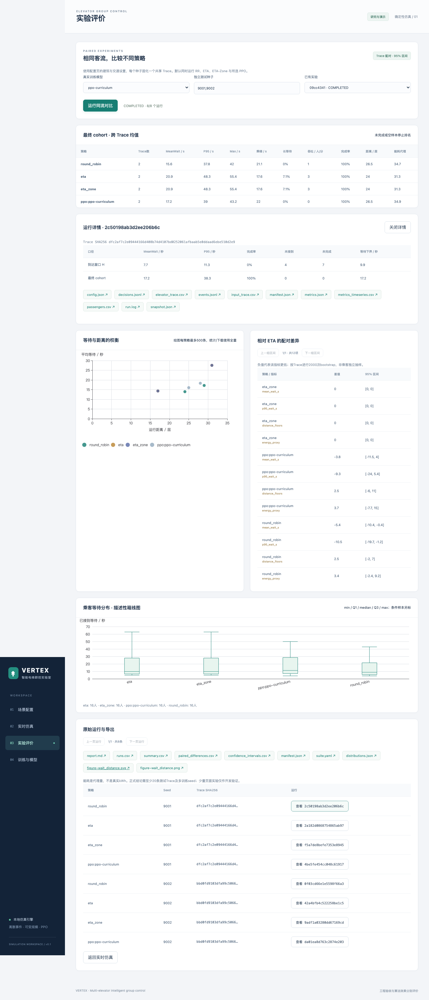
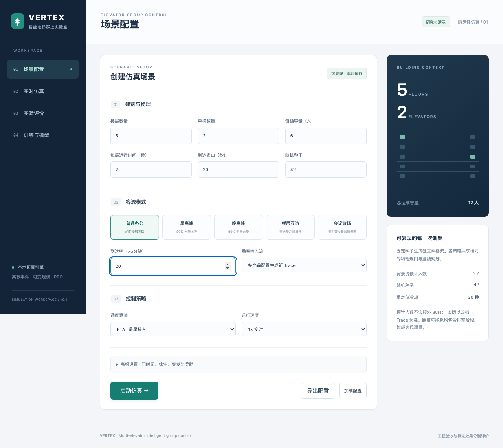

# 智能电梯实验室：零基础使用手册

2026-10-24起恢复首版运行状态。在模型下拉框中使用`ppo-curriculum`；仅保留第二轮两项离线对照，第三轮已删除；页面不展示历史优化模型或训练记录。第四轮及后续产物已删除。以下操作对应当前首版页面，建模细节见[当前PPO说明](../rl/前端PPO建模与流程.md)。

适用对象：第一次使用这个系统、不懂编程的使用者。你可以把它看成一个“电脑里的楼宇模型”：设置楼层、电梯和乘客数量，观察不同调度方法怎样接送乘客，再比较等待时间和电梯跑了多远。

系统用于研究和演示，不会控制真实电梯。一般操作只需要鼠标点击、输入数字，不需要写程序。界面中的绿色按钮是主要操作入口。

## 一、打开页面

1. 在这台已启动系统的电脑上打开浏览器，例如Chrome、Edge或Safari。
2. 点击浏览器最上方的地址栏，输入`http://127.0.0.1:8000`，按回车键。不要输入到页面内的搜索框里。
3. 出现“VERTEX 智能电梯群控实验室”和“场景配置”即表示打开成功。可以把这个地址加入浏览器收藏。

这个地址表示“当前这台电脑”。换到手机或另一台电脑输入同样地址，不会自动连接到本系统。若页面显示“无法访问此网站”，请联系项目管理员启动本地服务；不用下载或重新安装程序。

页面有四个入口：

| 入口 | 用来做什么 |
|---|---|
| 01 场景配置 | 设置楼层、电梯、乘客和算法 |
| 02 实时仿真 | 看电梯运行，暂停、继续、停止，下载结果 |
| 03 实验评价 | 让几种算法接送同一批乘客，公平比较 |
| 04 训练与模型 | 查看已经训练好的PPO及其学习记录 |

## 二、先用五分钟看懂已有对比

**这一段不需要新建实验，直接查看已经算好的正式结果。**

1. 点击“03 实验评价”。
2. 找到“已有实验”的下拉框，点击它。
3. 选择`standard · COMPLETED`。`COMPLETED`表示这次计算任务已经结束。等待表格和图形出现。
4. 在“最终 cohort · 跨 Trace 均值”表里，查看`round_robin`、`eta`、`eta_zone`和三个`ppo:ppo-seed…`的行。这个表标题的意思是“对每批乘客分别计算，再汇总”。
5. 先看完成率，再看平均等待和P95，最后看距离。常规标准实验的完成率都是100%。

这里三个PPO模型是三次独立训练的成果；表格会分三行显示，不会自动合并成一行。正式标准结果包含45种场景；只改变上方“真实训练模型”不会改动这份历史结果，它只影响下一次新建实验。

历史实验的显示名称会截取末尾8个字符：

| 页面中看到的名称 | 内容 |
|---|---|
| standard | 全部标准对比，初次建议看这个 |
| mixed | 一段时间内交通模式改变 |
| lization | generalization的末8位，测试不同楼宇的适应能力 |
| ablation | 去掉某个功能后重新比较，供研究人员分析 |
| pressure | 客流集中或高负载，可能有人截止时仍未完成 |
| 一串数字和字母 | 网页新建的小型实验，名称不是错误提示 |



上图用于认位置，是浏览器测试留下的一次小型实验截图；图里的数值不代表standard全部正式结果。

### 读懂表格中的词

| 名称 | 日常语言解释 | 怎么比较 |
|---|---|---|
| MeanWait / s | 平均等多久才登上电梯；s表示秒 | 越小越好 |
| P95 / s | 约95%的乘客等待不超过这个时间，关注等得较久的人 | 越小越好 |
| Max / s | 等待最久的那个人等了多久 | 越小越好 |
| 乘梯 / s | 登上电梯后，到离开电梯平均用了多久 | 越小越好 |
| 长等待 | 已接到乘客中，等待超过60秒的比例 | 越小越好 |
| 吞吐 / 人/分 | 指定到达窗口内，平均每分钟送达多少人 | 同样条件下一起看；它不包含排空阶段的送达 |
| 完成率 | 这批乘客有多少已送到目的地 | 先确认是否100% |
| 距离 / 层 | 所有电梯累计跑了多少层，包括空驶 | 相同乘客和完成度下越少越省运行 |
| 能耗代理 | 按运行距离、门和启动次数估出的相对消耗分数 | 越低越好；不是电表读数，也不是度电 |
| Trace数 | 参与比较的乘客批次数 | 不是人数；更多批次可减少偶然性 |

如果看到“未完成 / 无样本”或空白符号，不能据此认定某算法特别快。可能有人还没被接到，或者没有任何乘客。先检查完成率及未完成人数。

### 读懂三种图表

**等待与距离的权衡**：每个点是一种算法处理一批乘客的结果。点越靠下，平均等待越少；越靠左，电梯运行距离越短。因此通常希望往左下方移动。把鼠标放在点上可以查看数值；点击图例可暂时隐藏或显示一种算法。大实验每种算法最多画500个点，表格统计和下载仍使用全量数据。

**相对 ETA 的配对差异**：差值是“该算法减去ETA”。对等待、距离这类越小越好的指标，负值表示比ETA低。`[-8,-2]`表示本次估计的区间全部在0以下；`[-8,3]`跨过0，证据不足以稳定断言优于ETA。区间不代表每位乘客都能少等相同秒数。表格可以用“上一组区间”“下一组区间”翻页。

**乘客等待分布·描述性箱线图**：纵轴是等待秒数，箱子和中间线帮助看大部分人等多久。对本系统返回的箱线图，上下端点来自已接到者的最短/最长等待，箱子是中间50%、中线是中位数。若提示含未完成运行，只能用来观察已接到者，不能当作全体服务质量的排名依据。

## 三、亲自运行一次同流对比

“同流”就是让不同算法面对完全相同的乘客到达时间、出发楼层和目的地，像几位司机分别接送同一张乘客名单。

1. 点击“01 场景配置”。先用下面的小例子，其他选项保留默认值：

   | 选项 | 输入什么 | 含义 |
   |---|---|---|
   | 楼层数量 | 5 | 这栋楼有5层 |
   | 电梯数量 | 2 | 有2部电梯 |
   | 每梯容量（人） | 6 | 每部最多载6人 |
   | 每层运行时间（秒） | 2 | 电梯跑一层需要2秒 |
   | 到达窗口（秒） | 120 | 前120秒有新乘客出现 |
   | 客流模式 | 普通办公 | 不同楼层之间往来 |
   | 到达率（人/分钟） | 6 | 平均每分钟约6人，实际人数有波动 |

2. 不用点击“启动仿真”，直接点击“03 实验评价”。新实验会使用刚才配置页的楼宇和客流设置。
3. “真实训练模型”选择`ppo-curriculum`。这是演示用的现成模型；要研究某个正式模型，也可以选`ppo-seed101`、`ppo-seed202`或`ppo-seed303`。
4. “独立测试种子”首次保留`9001,9002`。它们相当于两张不同乘客名单的编号，用英文逗号隔开。
5. 点击一次“运行同流对比”。系统会自动运行轮询、ETA、ETA-Zone和所选PPO：2批乘客×4种算法，共8个运行。
6. 等状态变成`COMPLETED`，再看表格和图。不要在等待时反复点击按钮，以免重复创建实验。

如果希望每种算法比较20批乘客，可把种子一栏替换为下面这一整行，再新建实验：

```text
9001,9002,9003,9004,9005,9006,9007,9008,9009,9010,9011,9012,9013,9014,9015,9016,9017,9018,9019,9020
```

这会产生80个运行，可能需要更多等待时间。它只比较当前这一种楼宇/交通配置，仍不等于已有standard的45场景正式实验。少量结果只能说明当前样例，不能宣布PPO普遍更优。

**注意**：“真实训练模型”若选择“仅运行传统基线”，将只有三种经典算法，不包含PPO。训练种子、配置页随机种子和实验测试种子不是同一件事；在实验页新建对比时，该页的测试种子决定这次乘客名单，不会重新训练模型。

## 四、看电梯怎样运行

1. 点击“01 场景配置”，使用上面的小例子。
2. “调度算法”可选：

   | 选项 | 日常解释 |
   |---|---|
   | Round Robin · 轮转 | 按顺序轮流派给电梯 |
   | ETA · 最早接人 | 比较预计接人时间，选更早能接到的电梯 |
   | ETA-Zone · 热度重定位 | 使用ETA，并让空闲梯参考近期客流移动待命 |
   | PPO · 双任务强化学习 | 使用已经训练好的模型，决定派梯和空闲待命 |

3. 若选PPO，在“已训练模型”再选`ppo-curriculum`。未选模型时不能启动PPO运行。
4. “运行速度”先选“5×”。想看得更慢用“1× 实时”；只想快速拿结果用“最快”。这改变演示速度，不改变电梯物理参数和最终调度规则。
5. 点击“启动仿真 →”，页面自动切到“02 实时仿真”。



井道里的小方块代表电梯。`2/6`表示里面2人、最多6人；箭头表示上行或下行。绿色代表服务，黄褐色代表空闲梯移动待命，灰蓝色代表空闲。楼层旁`↑3 ↓1`表示这层有3人等上行、1人等下行。点击楼层可查看乘客详情并翻页；楼层很多时，在井道区域滚动查看较低楼层。

页面上的平均等待标注“已接到”，运行中只统计已经登梯的人。还有人在等时，这个数不能代表全体乘客的最终等待。到达窗口结束后进入“排空阶段”：不再生成新人，继续送完已到达的人，所以仿真时间超过120秒通常是正常的。

| 按钮 | 什么时候用 | 会发生什么 |
|---|---|---|
| 暂停 | 想仔细看当前状态 | 等“已暂停”后，模拟时钟停止 |
| 继续 | 暂停后接着看 | 从原来的地方继续 |
| 停止 | 不想继续这次运行 | 结束本次，可能仍有未完成乘客，保留已有结果 |
| 重置 | 想重新开始同一设置 | 保留旧记录，生成一个新的待启动运行，再点“开始” |
| 历史运行 | 想查看之前的运行 | 切到旧记录，不会自动把旧记录改成新结果 |

按钮变灰通常表示当前状态不能使用。例如已经完成就不能再暂停。关闭网页不会自动停止正在计算的任务；重新打开可从历史记录查看。刷新会重新加载配置页默认设置，尚未导出的设置应先保存。

## 五、保存与分享结果

**保存设置**：在配置页点击“导出配置”，浏览器会下载一个`.json`文件，可保留原文件名。以后点“加载配置”选择这个文件即可恢复设置。它保存的是设置，不包含全部运行结果。

**保存单次结果**：在实时仿真页，等完成或停止后，滚动到“归档与导出”，点击所需文件：

| 文件 | 保存了什么 |
|---|---|
| metrics.json | 本次主要指标 |
| passengers.csv | 每位乘客何时到达、登梯、到达目的地等明细 |
| input_trace.csv | 原始乘客名单，可用于相同条件复算 |
| metrics_timeseries.csv | 随时间变化的指标 |
| elevator_trace.csv | 电梯位置、载荷和状态 |

**保存算法对比**：在实验评价页向下滚到“原始运行与导出”。点击`report.md`下载文字报告；`runs.csv`是每次运行的指标，`summary.csv`是汇总，`confidence_intervals.csv`是区间，`figure~wait_distance.png`是容易分享的图片，`.svg`图放大更清晰。`.csv`一般可用Excel等表格软件打开，`.json`和`.md`可交给项目管理员或研究人员。

文件通常在浏览器“下载内容”或电脑“下载”文件夹中；也可以点击浏览器下载提示里的“在文件夹中显示”。分享时把配置、文字报告和图片一起发送，避免只发一张好看的图却缺少实验条件。

## 六、查看PPO学习记录

1. 点击“04 训练与模型”。
2. 在“训练记录”选`t3`查看课程最后一阶段，或选`formal-101`等查看正式独立训练。
3. “Reward 与固定验证”显示学习打分和固定验证结果；“验证 MeanWait / P95”更接近乘客的实际感受。
4. 向下看“已注册模型”，这里列出可用于仿真和比较的模型。

Reward是给学习过程的综合打分，不是节省了多少秒；曲线改善不能单独证明比经典算法更好。模型卡上的“真实决策”是选中checkpoint已训练的步数，可能小于该次训练的最终预算。`seed`是重复训练编号，`SHA256`是一段文件指纹，普通操作无需填写或修改。

本页用于查看训练结果，当前没有点击按钮重新训练的功能。改变配置页的奖励数字，也不会让现有模型立即学会新行为；需要研究人员重新训练并登记后，才能得到新模型。

## 七、常见情况

| 看到什么 | 建议怎么做 |
|---|---|
| 无法访问网站 | 核对完整地址；确认在启动系统的同一电脑上；联系管理员启动服务 |
| “服务连接失败”或“连接中” | 等一会儿，点击“重新连接”或刷新；不要连续新建任务 |
| 没有PPO模型可选 | 请管理员检查已登记模型，不能用随机模型当训练成果 |
| “正在创建…”或“排队中” | 系统在准备或等待计算位置，稍后查看状态 |
| `FAILED`或红色错误 | 这次任务失败；记下错误文字和运行编号，交给管理员，不把它当正常对比 |
| 完成率不到100% | 可能客流过大或排空截止；先看未接到/未完成人数，不能仅用较低平均等待宣布更好 |
| 到达率设成0，没有任何乘客 | 这是空流测试；没有样本时指标可能显示“—”或“暂无样本” |
| “最快”模式看不到电梯移动过程 | 计算可能很快就结束；看终态和归档趋势，或新建一次用1×/5×观看 |
| 改了配置但历史结果没变 | 历史结果保存原条件；要应用新设置需要新建运行或实验 |
| 页面很宽或内容看不全 | 左右滚动表格、上下滚动页面；建议用电脑和较宽窗口 |

不熟悉电脑时保留“高级设置”默认值；其中的完整配置JSON是给维护人员使用的文本。确需编辑时必须点击“校验并应用 JSON”，仅改文字不等于已生效。

## 八、一次演示的完成检查

你能完成这四件事，就已掌握日常使用：打开standard历史实验并看懂完成率；新建一次含PPO的同流对比；让一场仿真暂停后继续；下载一张对比图片和一份结果表。

当前正式研究结论是“PPO相对ETA等待改善，但距离明显增加，尚未全面胜过经典算法”。更详细的数据见[效果解读](../../reports/formal/策略效果解读.md)。系统的全部工程验收见[验收记录](../../reports/acceptance.md)。
