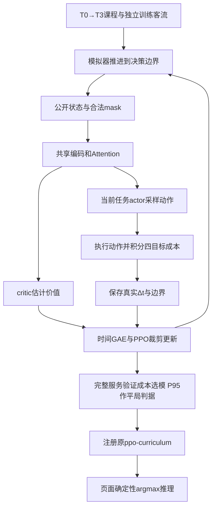

# 当前首版 ppo-curriculum：建模、训练与算法流程

2026-10-24恢复至首次生成`ppo-curriculum`时的实现，基准提交`18fd731`。第二轮两项对照已[离线归档](../../references/round2/README.md)，第三轮结果已删除，第四轮产物删除；本文仅描述当前启用的首版算法。

## 默认模型与任务

前端“PPO · 双任务强化学习”执行已注册的`ppo-curriculum`。两项任务分别为给新乘客选择电梯，以及让空闲电梯保持原位或前往区域代表楼层；两个任务共享编码器，由两个actor分支分别评分。页面仅推理，不进行在线训练。

默认模型为seed42、426631参数、Attention开启。它继承T0→T1→T2→T3课程；T3预算60000决策，按独立验证选中40960步checkpoint。40960不是整套课程的总训练量。本次恢复没有重训或改写权重。

## 事件驱动状态与动作

策略在派梯/重定位事件边界接收公开观测，动作推进到下一边界，真实经过的时间不固定。这是事件驱动SMDP接口；观测不读取未来乘客Trace。

| 输入 | 上限尺寸 | 内容 |
|---|---|---|
| 电梯状态 | 8×24 | 位置、方向、载客率、运行阶段、公开ETA等 |
| 电梯路线 | 8×30×8 | 已知接送停靠、顺序及公开到达预测 |
| 楼层状态 | 30×9 | 上下行等候、最长等待及近期到达等 |
| 当前请求 | 5 | 起终点、方向、已等待时长、有效标识 |
| 全局状态 | 20 | 等候、负载、空闲、历史到达率和时间等 |
| mask及任务标识 | 随输入 | 合法动作、有效梯/楼层、当前任务 |

动作共有13个槽：0–7派梯；8保持原位；9–12前往大堂/低区/中区/高区。每次只允许当前任务的合法动作，重复或不存在的目标被mask。公共路线规划器负责容量约束及可行插入，RL不直接控制电机或门。

## 原始四目标奖励

```text
r = -(Δ总等待/600
      + 0.2×Δ总乘梯时间/600
      + 0.05×Δ能耗代理/10
      + 0.5×Δ超长等待惩罚/10)
```

等待和乘梯时间均来自人数对真实经过时间的积分；超长等待惩罚对应超过60秒部分的平方增长。能耗是距离、启动和门操作的代理量。四项经各自尺度归一化，综合奖励不能保证每个指标都更好；P95不直接作为可加奖励。

## 深度网络与PPO

路线8→32→32编码后做有效楼层mean/max池化，拼接每梯24维状态送入共享88→128→128编码器。两层4头Attention建模各梯关系；楼层、请求和全局状态另作编码。Dispatch对各梯共享评分；Reposition结合当前空闲梯和全梯摘要输出5个分数；critic预测后续回报。有效mask和池化支持不同楼层/电梯数量，不使用固定梯编号位置嵌入。



折扣为`0.99^(Δt/10)`，GAE含`0.95^(Δt/10)`。自然终止不bootstrap，截断使用原episode最终观测；episode边界阻断递推。T3使用4环境、每环境128步rollout、4轮更新，学习率0.0003衰减至0.00003，clip0.2，熵系数0.01；actor/critic沿用首版联合优化和梯度裁剪。

保存旧策略概率后计算新旧概率比，以PPO裁剪目标、价值误差和熵项训练，并使用KL早停。验证先保证服务完整，再比较综合成本，P95作平局判据。部署从合法动作中取argmax，不启用后续轮次的候选代价先验、神经残差、塑形奖励或规则兜底。

对应源码：[network.py](../../src/elevator_control/rl/network.py)、[trainer.py](../../src/elevator_control/rl/trainer.py)、[buffer.py](../../src/elevator_control/rl/buffer.py)、[控制器](../../src/elevator_control/controllers/rl_controller.py)、[课程配置](../../configs/training/curriculum.yaml)。恢复证据见[验收](../../reports/baseline-restore/acceptance.md)。
