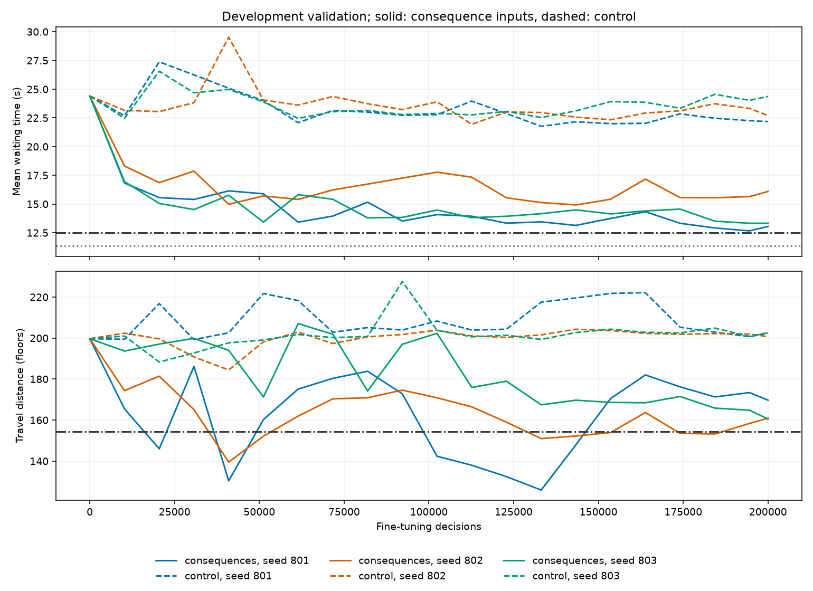

# 候选后果输入PPO研究结果

2026-10-24。**有界研究完成；尚未达到全部预定目标**。默认模型仍为原始 `ppo-curriculum`，研究候选保存在独立目录。

## 先清理，再开始的新实验

已按要求删除上一轮minimal-ppo的全部训练、15个T3候选、3个研究注册模型、实验/报告、专用代码与缓存；旧设计文本和history仅保留历史追溯。首版8模型和第二轮规则/401参考保留，9份权重SHA不变。[清理记录](cleanup.json)

本轮把逐梯插单后果作为神经网络输入：新乘客接人/送达时间、新增距离、已有任务接人/送达延误总和、路线延长。派梯网络为MLP([电梯编码, 请求和全局上下文, 六项后果])；新增768参数，不加固定候选代价、规则分数、教师动作、行为克隆或兜底。六列新增输入权重以0初始化，由PPO自行学习。原奖励、GAE、Attention、价值项系数0.5和重定位任务不变。

完成12个候选训练，总计1,560,000个微调决策。801/802/803是从同一原始已训练PPO开始的独立微调随机种子，**不是三个独立预训练模型**。6万与20万阶段分别从同一原权重重新训练，并非更改resume预算；两组同预算对照共享验证方法。

## 同流开发结果

45场景×3条新非空输入，共135组。先算每运行指标，再按场景与微调seed等权汇总。P95是每流P95再平均，距离包含排空。这些结果参与了选模，不能冒充独立盲测。

| 策略 | 平均等待/秒 | P95/秒 | 距离/层 |
|---|---:|---:|---:|
| eta | 35.8772 | 132.7466 | 147.1185 |
| eta_zone | 25.9598 | 106.3103 | 175.8963 |
| round_robin | 25.6363 | 80.7696 | 222.3111 |
| fixed-rule | 11.3546 | 27.0252 | 137.0889 |
| ppo-curriculum | 24.4030 | 75.0211 | 199.6741 |
| consequences / 60000（3seed均值） | 14.7109 | 40.4888 | 152.4765 |
| control / 60000（3seed均值） | 22.7904 | 69.5213 | 198.2889 |
| consequences / 200000（3seed均值） | 13.7975 | 36.4108 | 153.5728 |
| control / 200000（3seed均值） | 25.5432 | 79.4068 | 192.7852 |

在最终预算开发结果中，候选输入相对同预算控制组等待变化-45.98%，距离变化-20.34%；相对原默认PPO等待变化-43.46%；相对固定规则等待变化+21.51%。不能把其中任意一个参照替代其余要求。

原始初始化0步也参与保护性选模。选中0步或新增输入权重仍为0时不算新输入学习成功；无可行模型时的best仅为诊断候选。

## 每个模型与约束

| 模型 | 获选步数 | 等待/秒 | P95/秒 | 距离/层 | 候选列范数 | 可行 |
|---|---:|---:|---:|---:|---:|---|
| control-s803-n200000 | 20480 | 26.5602 | 81.1019 | 188.3259 | 0.0000 | False |
| control-s803-n60000 | 60000 | 23.6137 | 72.5490 | 197.6667 | 0.0000 | False |
| control-s802-n200000 | 30720 | 23.8244 | 74.3920 | 190.7852 | 0.0000 | False |
| control-s801-n60000 | 30720 | 23.3742 | 72.4756 | 197.6519 | 0.0000 | False |
| consequences-s802-n60000 | 51200 | 14.4006 | 38.5235 | 143.4370 | 0.7066 | True |
| control-s801-n200000 | 30720 | 26.2449 | 82.7266 | 199.2444 | 0.0000 | False |
| control-s802-n60000 | 40960 | 21.3833 | 63.5393 | 199.5481 | 0.0000 | False |
| consequences-s801-n200000 | 143360 | 13.1399 | 33.0974 | 147.9481 | 1.7148 | True |
| consequences-s801-n60000 | 30720 | 15.3069 | 43.7465 | 161.3037 | 0.4746 | False |
| consequences-s803-n60000 | 60000 | 14.4252 | 39.1963 | 152.6889 | 0.6243 | True |
| consequences-s802-n200000 | 143360 | 14.9229 | 41.6286 | 152.2444 | 1.0492 | True |
| consequences-s803-n200000 | 200000 | 13.3298 | 34.5065 | 160.5259 | 1.2377 | False |

所有表中模型均完成其标注预算，获选步数是验证选择的检查点。完整逐流验证、episodes/updates、训练配置与检查点保存在 `artifacts/candidate-ppo/`；机器可读记录见[models.csv](models.csv)。

上图实线为新增后果输入，虚线为同预算控制组；等待面板灰色点线为固定规则、黑色点划线为规则110%门槛，距离面板黑色点划线为最严格经典算法105%上限。全部为开发曲线，不是测试集分数。

## 是否达到目标

状态：`COMPLETED_NEGATIVE`；确认集打开：False；最终测试打开：False；全目标通过：False。原因：bounded development gate failed。

本开发集规则等待110%门槛为12.4901秒；各seed的距离上限中最严格为154.4744层，P95同样不能超过任何经典基线105%。等待必须优于三基线、报告各seed而非仅最好seed。

| 开发门槛 | 结果 |
|---|---|
| 组均值等待比三种经典都减少至少5% | True |
| 每个微调seed的等待均优于三种经典 | True |
| 每个微调seed的P95≤各经典105% | True |
| 每个微调seed的距离≤各经典105% | False |
| 组均值等待≤固定规则110% | False |

上述通过只代表开发检查。每个seed的距离单独判定，不能用三seed距离均值掩盖某一个seed超限；距离可行的较早检查点与训练末步也分别记录。

确认450条、最终标准1350条输入在配置冻结前不用于选模；协议还封存长窗口、训练未见建筑/外推和压力输入。未通过开发门槛时按协议不打开这些数据，不通过增加测试次数或弱化阈值制造改善。即使本轮有较大开发改善，也必须单独说明是否接近规则与是否具备独立证据。

## 模型是否真正使用了候选信息

推理消融只将同一个已训练模型的六项输入置零，不重训、不改其他输入或规则；它是输入分布外诊断，不能当作新的独立算法成绩。

| 同一检查点 | 原输入等待/秒 | 六输入置零等待/秒 | 置零后完整服务 |
|---|---:|---:|---|
| consequences-s801-n200000 | 13.1399 | 22.7052 | True |
| consequences-s802-n200000 | 14.9229 | 24.0517 | True |
| consequences-s803-n200000 | 13.3298 | 23.1838 | True |

候选列的实际训练更新与置零消融结合判断输入使用程度；局部分数导数见[feature-sensitivity.json](feature-sensitivity.json)，它随状态变化，并非人工规定的全局系数。新增信息有用不等于已经证明比固定规则更优。

## 工程与独立核验

- 完整质量10/10通过：Python87、Vitest2、Playwright5；类型/格式/构建与真实链路均通过，见[快照](quality/checks.json)。
- 原8模型×24真实公开状态输出逐位不变，保留9份权重SHA不变；关闭候选输入后128步实际训练的56个张量及随机状态与首版相同。
- 特征回归改变尚未到达乘客的目的地与人数，当前候选结果不变；合法mask、padding/置换、补零迁移、真实训练/注册和版本拒绝均通过。
- 1892次原始运行、61813条乘客记录独立重算通过；重复运行不增加独立输入样本数。选中检查点的重算指标与验证结果一致。
- 研究模型注册到独立目录，5F2E和30F8E的实际API/worker完成服务，指标与离线推理一致；原默认模型未覆盖。
- 空输入在任何策略运行前按固定非空入组规则记录和补足，原因、seed和哈希保留，不把空等待填零或按策略结果换客流。

证据：[协议](protocol.json)、[先导扩预算判定](pilot-decision.json)、[开发选择](decision.json)、[旧路径兼容](legacy-compatibility.json)、[原始审计](raw-audit.json)、[输入消融](selected-raw-and-ablation.json)、[模型集成](model-integration.json)。实现、运行方式与边界见[模块文档](../../docs/rl/candidate-ppo.md)及[特征设计](../../docs/env/candidates.md)。
