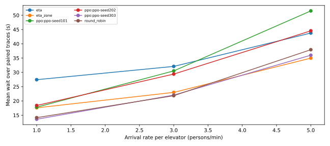
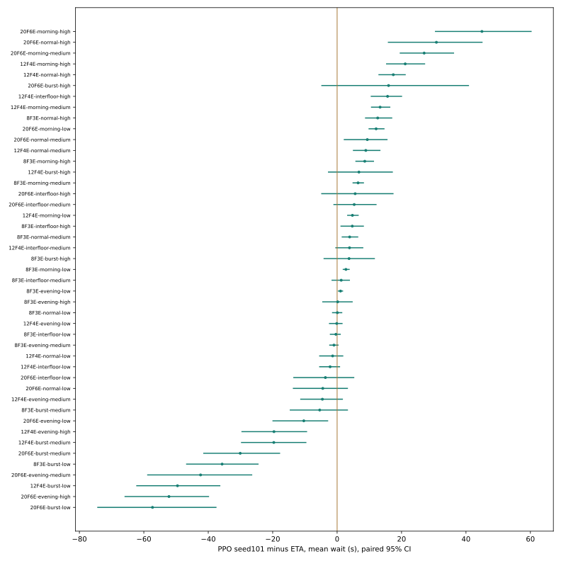

# 正式实验报告

本报告基于预先固定的独立测试矩阵。到达窗口120秒，常规排空上限7200秒（压力矩阵1800秒）；每常规格20条独立Trace。3个完整PPO为独立随机初始化，训练seed 101/202/303，每个60000决策。本次并未执行原建议的百万决策预算，也不把短窗口实验解释为长时稳态效果。

## 矩阵完整性

| 矩阵 | 已完成/预定 | 未完成cohort | 空cohort | 原始索引 |
|---|---:|---:|---:|---|
| standard | 5400/5400 | 0 | 0 | `artifacts/experiments/standard/runs.csv` |
| mixed | 120/120 | 0 | 0 | `artifacts/experiments/mixed/runs.csv` |
| generalization | 2400/2400 | 0 | 0 | `artifacts/experiments/generalization/runs.csv` |
| ablation | 1800/1800 | 0 | 0 | `artifacts/experiments/ablation/runs.csv` |
| pressure | 50/50 | 26 | 0 | `artifacts/experiments/pressure/runs.csv` |

## 主要结果

以下为每条Trace指标的等权均值，非把所有乘客当独立样本。P95为每Trace内部P95再跨Trace平均。所有未完成和空样本均明确保留，禁止以条件均值排名。

```csv
controller,mean_wait_s,p95_wait_s,max_wait_s,mean_travel_s,long_wait_ratio,completion_ratio,distance_floors,energy_proxy
eta,34.43261108103239,121.36168413705553,156.76220818444443,57.27545602982442,0.1464975451835297,1.0,139.96,189.64799999999997
eta_zone,25.189368453413145,98.25503990444442,131.22377719444444,49.00297137793056,0.10370472455986202,1.0,168.00222222222223,218.0173333333332
ppo:ppo-seed101,33.28402698787791,104.28025192405553,129.91810994333335,45.59250916595763,0.1478429252360987,1.0,198.5811111111111,257.931888888889
ppo:ppo-seed202,30.784520711031828,91.74965319716664,124.68793633555555,51.698421380460495,0.15334542845114976,1.0,227.13222222222248,292.041666666665
ppo:ppo-seed303,23.882857361844444,71.43983681188888,98.22507365,47.27927468502774,0.09211137653003325,1.0,225.7888888888891,288.28577777777645
round_robin,24.64265997795809,78.10514391361109,112.11344650444444,48.95089038326114,0.09806897889257261,1.0,218.70888888888888,285.1861111111115

```

## 中负载效果目标

MeanWait变化 -14.87%，P95变化 -29.65%，距离变化 59.74%。建议目标（等待改善≥5%，P95/距离恶化≤5%，完整服务）：未达到。

软件流程和工程验收独立于该效果目标；没有弱化ETA、替换Trace或排除差场景来制造提升。

## 泛化、消融与不确定性

12F3E和18F5E在训练与验证采样中明确排除，24F7E和30F8E超过训练域上限。所有泛化直接使用同一原模型，不追加训练。逐场景结果见generalization/runs.csv与配对区间。

完整seed101、同模型强制Stay、重新训练Dispatch-only、无Attention、无公平性，均有独立标识；3个重新训练消融均与完整模型同seed101、60000决策预算。参数量与种子记录在模型metadata。原始结果位于ablation/runs.csv，不能把直接禁用动作与重新训练混为一谈。

每模型seed的区间按Trace配对bootstrap2000次。跨3模型seed采用先抽模型seed、再抽配对Trace的分层bootstrap，区间及跨seed均值范围见hierarchical_intervals.csv。3个训练seed仅提供有限的模型方差估计。

## 表现较差的场景（全部结果仍保留）

- 20F6E-morning-high: MeanWait比ETA增加 17.39s，分层95%区间 [0.78,41.95]。
- 20F6E-morning-medium: MeanWait比ETA增加 13.59s，分层95%区间 [5.07,25.19]。
- 20F6E-normal-high: MeanWait比ETA增加 13.13s，分层95%区间 [-1.50,29.66]。
- 12F4E-normal-high: MeanWait比ETA增加 13.10s，分层95%区间 [6.73,18.35]。
- 12F4E-morning-high: MeanWait比ETA增加 12.13s，分层95%区间 [5.43,20.14]。

## 解释与限制

ETA直接使用同一可行插入的精确预计接人时间，是强启发式基线。PPO的mask保证合法性而非最优性；有限预算、未见交通强度及长路线压缩均可造成较差服务时间。负奖励改善不自动意味着P95改善。公平性代价使用超时平方增量，能耗为明确系数的相对代理，不是真实kWh。

120秒短暴露对初始全部大堂和重定位冷却敏感。应通过full.yaml延长训练，并增加1800秒及更长暴露后再讨论生产结论；本系统不连接真实电梯。所有预算、原始输入、模型哈希及运行明细已保留，结果可用原命令复现。





训练明细：training_seeds.csv；硬件：../training_hardware.json；模型注册表：artifacts/models；最终工程验收见../acceptance.md。

## 消融的实际结果

下表使用完全相同300条Trace；重新训练变体与完整seed101均为60000决策。单个训练seed的消融不构成跨seed稳定因果结论。

```csv
controller,mean_wait_s,p95_wait_s,max_wait_s,long_wait_ratio,completion_ratio,distance_floors,energy_proxy
eta,32.090409459008505,117.25733493433329,155.27203656,0.13778740118889019,1.0,141.40666666666667,191.54999999999998
ppo:ppo-dispatch-only,22.351151196456833,66.83981528749997,94.38844431666666,0.08080516165571942,1.0,220.41333333333338,285.75066666666675
ppo:ppo-no-attention,19.609345938507808,53.58025169349999,75.55733974333333,0.06138230110754667,1.0,221.22,287.37900000000013
ppo:ppo-no-fairness,21.015944500082444,58.86533400016665,84.27800624333332,0.06709240897885801,1.0,250.11000000000024,315.25799999999776
ppo:ppo-seed101,30.514355278035953,95.19180491516664,120.03384852,0.14282339582359177,1.0,211.62666666666667,273.88566666666674
ppo_stay:ppo-seed101,30.514355278035953,95.19180491516664,120.03384852,0.14282339582359177,1.0,211.62666666666667,273.88566666666674

```

逐场景相对完整seed101的20条Trace配对差异及2000次区间见ablation_vs_full.csv。

## 泛化的实际结果

同一checkpoint直接测试，不在held-out或外推配置追加训练。下表为域内描述性均值，各配置的配对区间单独保留在原矩阵。

```csv
domain,controller,mean_wait_s,p95_wait_s,completion_ratio,distance_floors
extrapolation low,eta,56.834028638815134,172.34086809124997,1.0,182.12
extrapolation low,ppo:ppo-seed101,34.12722201810797,82.87624020899999,1.0,303.865
extrapolation low,ppo:ppo-seed202,33.75475047522395,88.56274689674997,1.0,370.38000000000017
extrapolation low,ppo:ppo-seed303,24.91368482822159,57.44759072874999,1.0,400.70500000000027
extrapolation medium,eta,88.16057797654247,308.07932850399993,1.0,367.185
extrapolation medium,ppo:ppo-seed101,72.64314819079262,229.09642983499995,1.0,576.245
extrapolation medium,ppo:ppo-seed202,51.50009207095438,156.91579933499997,1.0,619.715000000002
extrapolation medium,ppo:ppo-seed303,42.185776163250566,131.62107984949998,1.0,621.1300000000009
held-out interpolation,eta,35.36854126952391,127.22093044999998,1.0,143.96
held-out interpolation,ppo:ppo-seed101,35.58407468860345,111.83689602149998,1.0,212.51
held-out interpolation,ppo:ppo-seed202,33.760013094347975,99.20216575749997,1.0,230.64000000000016
held-out interpolation,ppo:ppo-seed303,25.204268813280923,73.48607648574998,1.0,230.14500000000015

```

## 压力与排空截止

压力50次中26次cohort未在1800秒drain内全部完成。仅报告完成度、未接到/未完成和等待下界，不按已接到者条件均值排名。

```csv
controller,runs,complete_cohorts,completion_ratio,unpicked,unfinished,mean_wait_lower_bound_s
eta,10,10,1.0,0,0,276.78561677791276
ppo:ppo-seed101,10,3,0.8743678304352823,375,423,640.9060652201447
ppo:ppo-seed202,10,1,0.6637964487685064,995,1082,878.8997391221774
ppo:ppo-seed303,10,0,0.7930397475560466,598,685,706.6524097675411
round_robin,10,10,1.0,0,0,325.4385206231929

```

中负载等待改善同时距离增加，本次标量奖励没有保证距离5%约束。有限预算、确定性argmax集中派单、重定位空驶和事件信用分配仍需研究；这些结果不构成已达到生产调度目标的证据。
